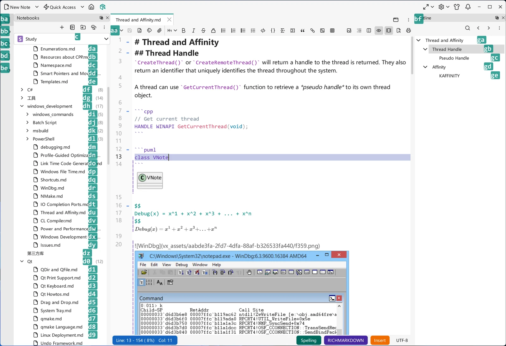

# 键盘快捷键

VNote 生来就是为键盘操作而设计的。几乎每个操作都有快捷键，许多操作使用**组合序列快捷键**（chord，先按一个组合，再按另一个），而且整套方案都可配置。将其与 [Vi 模式](../editing/vi-mode.md)结合，你几乎可以完全脱离鼠标工作。

## 组合序列快捷键

VNote 的部分快捷键是组合序列，写作以逗号分隔的两部分。例如：

- `Ctrl+G, S`——打开[片段](../editing/snippets.md)面板：按 `Ctrl+G`，松开，再按 `S`。
- `Ctrl+G, I`——在光标处应用一个片段。
- `Ctrl+G, G`——激活[统一入口](../search/united-entry.md)。

`Ctrl+G` 前缀引出一系列「跳转 / 全局」操作；输入前缀后，VNote 会向你显示后续按键。

## 导航模式

**导航模式**让你只需几次按键就能抵达某个部件，无需使用鼠标。按下 `Ctrl+G, W`，VNote 会在你此刻可以导航到的对象上叠加按键标签——可能是整个部件，也可能是其中的各个条目；输入目标上显示的按键或两键序列即可。任何不匹配的按键都会取消该模式，因此按 `Esc` 就能退出。

{ .screenshot loading=lazy }

## 停靠部件与窗口的默认快捷键

下面这些应用级操作是你日常最常用的。名称即 `core.shortcuts` 中使用的键名，`Ctrl+G` 是可配置的前导键：

| 操作 | 默认按键 | 作用 |
|------|----------|------|
| `NavigationDock` | `Ctrl+G, A` | 聚焦笔记本停靠部件。 |
| `OutlineDock` | `Ctrl+G, U` | 聚焦大纲停靠部件。 |
| `SnippetDock` | `Ctrl+G, S` | 聚焦片段停靠部件。 |
| `LocationListDock` | `Ctrl+G, C` | 聚焦位置列表停靠部件。 |
| `SearchDock` | 未绑定 | 聚焦搜索停靠部件。 |
| `HistoryDock` | 未绑定 | 聚焦历史停靠部件。 |
| `TagDock` | 未绑定 | 聚焦标签停靠部件。 |
| `ConsoleDock` | 未绑定 | 聚焦控制台停靠部件。 |
| `CloseFocus` | `Ctrl+G, X` | 关闭当前聚焦的停靠部件——若焦点在编辑器上，则关闭当前标签页。 |
| `Detach` | `Ctrl+G, Shift+D` | 把当前视图分离为独立窗口。 |
| `StayOnTop` | `F10` | 把分离窗口固定在其他窗口之上。 |
| `Export` | `Ctrl+G, T` | 打开[导出](../productivity/export.md)对话框。 |
| `UnitedEntry` | `Ctrl+G, G` | 激活[统一入口](../search/united-entry.md)。 |

标为未绑定的操作没有默认按键；可按下文所述在 `core.shortcuts` 中为它们指定。

!!! note "`CloseTab` 已改名"
    原先名为 `CloseTab` 的操作现已改名为 `CloseFocus`。已有 `vnotex.json` 中自定义的 `CloseTab` 绑定仍然有效，并会在下次保存配置时以 `CloseFocus` 写回。

## 视图演示与全局快速笔记

**PresentationMode** 默认为 `F9`，属于 `editor.core.shortcuts`，不在上面的应用级操作表中。它会演示当前的 [Markdown](../editing/editor-basics.md)、[文本](../editing/text.md)、[思维导图](../editing/mind-maps.md)或 [PDF](../managing-notes/pdf-viewer.md) 视图，按 `Escape` 退出。它与主窗口的 `FullScreen` 操作（`F11`）不同。

**NewQuickNote** 使用 `core.shortcuts.NewQuickNote`（默认为 `Ctrl+Alt+Q`），VNote 运行期间会将其注册为全局热键，能否使用取决于操作系统支持及快捷键冲突情况。即使主窗口隐藏，它也能打开[快速笔记](../productivity/quick-note.md)方案选择器。默认开启的**允许 Ctrl+Alt 快捷键**设置可在关闭并重启后停用它及其他 `Ctrl+Alt` 绑定；参见[设置](settings.md#general-settings)。

## 快捷键在哪里定义

快捷键位于主配置文件 `vnotex.json` 中，分为两张表：应用级操作在 `core.shortcuts` 之下，编辑器/编辑类操作（保存、加粗、标题、查找、应用片段等）在 `editor.core.shortcuts` 之下。每个操作映射到一个按键序列，例如：

```json
"core": {
    "shortcuts": {
        "UnitedEntry": "Ctrl+G, G",
        "FullScreen": "F11"
    }
},
"editor": {
    "core": {
        "shortcuts": {
            "ApplySnippet": "Ctrl+G, I",
            "PresentationMode": "F9"
        }
    }
}
```

要查看每个操作及其默认绑定的权威列表，请查看你的 `vnotex.json` 中的 `core.shortcuts` 和 `editor.core.shortcuts` 段落（默认值由 VNote 填入）。这些文件夹的位置以及默认/用户层的工作方式参见[设置](settings.md)。

## 自定义快捷键

1. 打开你的**用户**配置 `vnotex.json`。
2. 在 `core.shortcuts`（应用操作）或 `editor.core.shortcuts`（编辑操作）下，把值改为你想要的按键序列，使用相同的 `Modifier+Key` 与逗号组合序列写法。
3. 重启 VNote 使更改生效。

由于快捷键只是配置，你也可以通过同步用户配置在机器之间携带你的绑定——参见[设置](settings.md)与[让 VNote 便携化](settings.md#make-vnote-portable)。

## 快捷键与 Vi 模式

启用 [Vi 模式](../editing/vi-mode.md)后，Vi 按键处理笔记**内部**的文本编辑（移动、操作符，插入/普通/可视模式），而 VNote 的应用快捷键继续处理应用级操作——切换笔记、切换停靠部件、打开统一入口、应用片段等等。两层共存：Vi 用于编辑文本，VNote 快捷键用于操控应用。

## 小贴士

- 先掌握 `Ctrl+G` 前缀——它解锁片段与统一入口这两项最省时的功能。
- 导航模式（`Ctrl+G, W`）是抵达那些你很少点击的部件的最快方式。
- `Ctrl+G, A` 无需进入导航模式，可直接跳转到笔记本停靠部件。
- 如果你围绕快捷键编写脚本，可在[任务](../productivity/tasks.md)中用 `${config:main.core.shortcuts.<Action>}` 引用它们。
- 如果某个快捷键似乎无效，检查相应快捷键表中的冲突、Ctrl+Alt 策略，并确认编辑文件后已重启 VNote。全局热键还需要操作系统成功注册。
