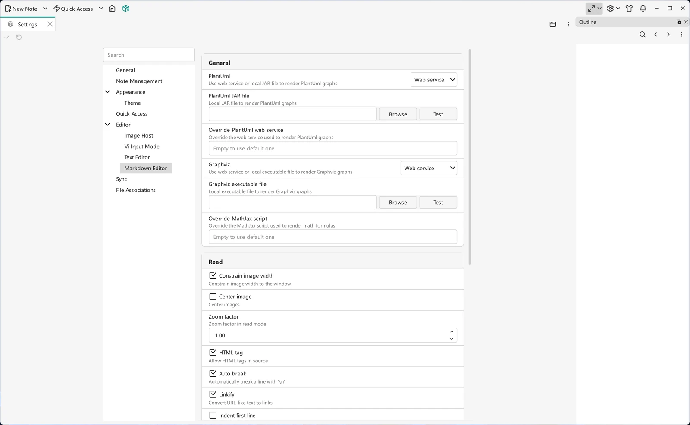

# Settings

Most of VNote's behavior can be adjusted, either through the **Settings** tab or by editing configuration files directly. This page explains how VNote's configuration is layered, where the files live, and how to make VNote portable.

## The Settings tab

Choose **Settings → Settings** from the main toolbar to open a tab in the main window, where you can change common options — appearance and [theme](themes-and-styles.md), editor behavior, [Vi mode](../editing/vi-mode.md), read/render options, [image host](../editing/images-and-image-host.md), and more. Click **Apply**, or use the editor **Save** shortcut (`Ctrl+S` by default), to save changed settings. Most supported changes apply immediately; follow any restart or reopen notice for the option you changed. **Edit JSON** on the Settings toolbar opens your `vnotex.json` in VNote for options not exposed in the form; see the configuration layers below.

{ .screenshot loading=lazy }

## General settings

Under **Settings → General**, you can control startup, naming, and shortcut policy:

- **Application display name** changes the name shown in window titles, the system tray, and **About**. Restart VNote after saving; an empty value resets the name to `VNote`.
- **Start VNote on system startup** is available on Windows. Enable it to launch the current VNote executable automatically when you sign in to your Windows account. Saving the setting reports an error if the per-user startup entry cannot be updated.
- **Allow Ctrl+Alt shortcuts** is on by default. Disable it to avoid conflicts with `AltGr` on some keyboard layouts, then restart VNote. It suppresses configured shortcuts containing `Ctrl+Alt`, including global hotkeys, without deleting your custom bindings.

## Layers of configuration

VNote's configuration is layered, applied in order:

- **Default configuration** — the application's built-in defaults. These live inside the program itself; there is no annotated file on disk to copy from. To customize a value, set it in your *user configuration* file, where it overrides the default.
- **User configuration** — your overrides in the main `vnotex.json` file, in the user configuration folder. Anything here takes precedence over the defaults.
- **Session configuration** — session state such as the notebook list and the main window's geometry. This is the `session.json` file. VNote writes it continuously while running and flushes it on close, so close VNote before editing it by hand.

## What's in the configuration folder

Choose **Settings → Open Configuration Folder** to locate your configuration. The folder contains several folders and the main file:

```
.
├── dicts               (dictionaries for spellcheck)
├── syntax-highlighting (Kate syntax-highlighting files for the text editor)
├── tasks               (task definitions; see Tasks)
├── themes              (VNote themes)
├── web                 (resources used by read mode)
└── vnotex.json         (main configuration file)
```

To customize the fields in `vnotex.json`, add or edit the keys you need — VNote merges your file over its built-in defaults. Related per-feature folders you will see referenced elsewhere include `tasks` (see [Tasks](../productivity/tasks.md)) and `templates` (see [Templates](../editing/templates.md)).

## Make VNote portable

You can bundle the configuration next to the executable so the whole setup travels together — for example on a USB drive:

1. Close VNote first.
2. Create a folder named `config` next to the executable (such as `vnote.exe`).
3. Inside it, VNote uses two subfolders: `app` (application settings, including `vnotex.json`) and `local` (session and cache, including `session.json`). VNote creates them on first run.

When a `config` folder exists next to the executable at startup, VNote reads and writes configuration there instead of the system-wide location.

## Related customization

- [Themes & Styles](themes-and-styles.md) — change the look of the interface, editor, and read mode.
- [Keyboard Shortcuts](keyboard-shortcuts.md) — remap actions, including [United Entry](../search/united-entry.md).
- [Mind Maps](../editing/mind-maps.md) — native editor settings and when to reopen a map.
- [Notebooks, Folders & Notes](../managing-notes/notebooks-folders-notes.md) — notebook-specific recycle bin location and retention settings.
- [Encrypted Notes](../managing-notes/encrypted-notes.md) — protection settings and **Settings → Lock All**.
- If VNote crashes after a version update, deleting `vnotex.json` from the user configuration folder is a common fix — see the [FAQ](../help/faq.md).
