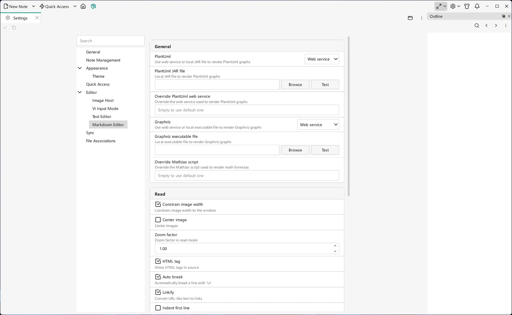

# 设置

VNote 的大部分行为都可以调整，既可以通过**设置**标签页，也可以直接编辑配置文件。本页说明 VNote 的配置是如何分层的、文件位于何处，以及如何让 VNote 便携化。

## 设置标签页

从主工具栏选择**设置 → 设置**，它会以标签页的形式在主窗口中打开，你可以在其中更改常用选项——外观与[主题](themes-and-styles.md)、编辑器行为、[Vi 模式](../editing/vi-mode.md)、阅读/渲染选项、[图床](../editing/images-and-image-host.md)等。点击**应用（Apply）**或使用编辑器的**保存**快捷键（默认为 `Ctrl+S`）来保存改动。大多数支持即时更新的设置会直接生效；若选项提示需要重启或重新打开，请按提示操作。设置工具栏的**编辑 JSON（Edit JSON）**会在 VNote 中打开你的 `vnotex.json`，便于配置表单未提供的选项；配置层级见下文。

{ .screenshot loading=lazy }

## 常规设置 { #general-settings }

**设置 → 常规**可以控制启动方式、显示名称和快捷键策略：

- **应用显示名称（Application display name）**会更改窗口标题、系统托盘和**关于**中显示的名称。保存后请重启 VNote；留空会把名称重置为 `VNote`。
- **系统启动时启动 VNote（Start VNote on system startup）**仅在 Windows 上提供。启用后，当前 VNote 可执行文件会在你登录 Windows 账户时自动启动。如果无法更新当前用户的启动项，保存设置时会报告错误。
- **允许 Ctrl+Alt 快捷键（Allow Ctrl+Alt shortcuts）**默认开启。如果某些键盘布局的 `AltGr` 键发生冲突，可以关闭此项并重启 VNote。它会停用包含 `Ctrl+Alt` 的已配置快捷键（包括全局热键），但不会删除你的自定义绑定。

## 标签页与预览 { #tabs-and-previews }

- **设置 → 笔记管理 → 总是在新标签页中打开笔记（Always open notes in new tabs）**控制普通笔记的打开方式。关闭后会复用当前标签页；激活笔记时按住 `Ctrl` 可请求新标签页。替换前仍会询问如何处理未保存的修改。参见[编辑器基础](../editing/editor-basics.md#tabs-splits-and-navigation)。
- **设置 → 编辑器 → 在浮层中预览链接（Preview links in an overlay）**会在源笔记上方打开受支持的本地文件链接。对于 Markdown 链接，目标必须可解析到已打开的笔记本；笔记本外的文件可能改由系统应用打开。链接右键菜单的**打开链接（Open Link）**可绕过浮层。参见[链接预览](../editing/editor-basics.md#link-previews)。
- **设置 → Markdown 编辑器 → 阅读 → 卸载不活跃网页视图的等待时间（Unload inactive web view after）**会在标签页隐藏指定分钟数后释放 Markdown 网页视图，默认 **5** 分钟。范围为 **0–1440 min**，**0** 显示为**从不（Never）**。返回标签页时会从当前 Markdown 重建预览，不丢失未保存的文本或撤销历史。

## Markdown 安全与数学公式 { #markdown-safety-and-math }

**设置 → Markdown 编辑器 → 阅读 → 保护 Markdown 免受 XSS 攻击（Protect Markdown from XSS）**会阻止 Markdown 阅读器、实时预览和导出中的不安全 HTML 与 URL。请保持启用，仅在笔记完全可信时才关闭。[加密笔记](../managing-notes/encrypted-notes.md)始终强制过滤，不受此开关影响。

Markdown、[Typst](../editing/typst.md) 和思维导图共用外部链接警告及其**不再询问（Never Ask）**偏好，并会记住该选择。它不会关闭独立的本地文件警告，也不会绕过受保护笔记的授权与锁定保护。

**设置 → Markdown 编辑器 → 数学公式渲染器（Math renderer）**可选择 **KaTeX**（默认）、**MathJax** 或 **Typst**。Typst 在原有美元符号分隔符内使用自己的语法；`typst` 围栏块不受该选择影响。示例与受保护笔记的限制参见[数学与图表](../editing/math-and-diagrams.md)。

## 配置的层级

VNote 的配置是分层的，按顺序应用：

- **默认配置**——应用内置的默认值。它们内建于程序之中，磁盘上没有可供复制的文件。若要自定义某个值，在你的*用户配置*文件中设置它，它会覆盖默认值。
- **用户配置**——你在用户配置文件夹中的主文件 `vnotex.json` 里的覆盖设置。这里的任何内容都优先于默认值。
- **会话配置**——会话状态，例如笔记本列表和主窗口的几何布局。它是 `session.json` 文件。VNote 在运行期间会持续写入它，并在关闭时刷新落盘，因此手动编辑前请先关闭 VNote。

## 配置文件夹里有什么

选择**设置 → 打开配置文件夹（Open Configuration Folder）**即可定位配置。该目录包含若干文件夹和主文件：

```
.
├── dicts               （拼写检查词典）
├── syntax-highlighting （文本编辑器的 Kate 语法高亮文件）
├── tasks               （任务定义；参见「任务」）
├── themes              （VNote 主题）
├── web                 （阅读模式使用的资源）
└── vnotex.json         （主配置文件）
```

要自定义 `vnotex.json` 的字段，添加或编辑你需要的键即可——VNote 会把你的文件合并到内置默认值之上。你在别处会看到引用的按功能划分的相关文件夹包括 `tasks`（参见[任务](../productivity/tasks.md)）和 `templates`（参见[模板](../editing/templates.md)）。

## 让 VNote 便携化 { #make-vnote-portable }

你可以把配置与可执行文件放在一起，让整套环境一同迁移——例如放在 U 盘上：

1. 先关闭 VNote。
2. 在可执行文件（如 `vnote.exe`）旁边创建一个名为 `config` 的文件夹。
3. 在其中，VNote 会使用两个子文件夹：`app`（应用设置，包含 `vnotex.json`）和 `local`（会话与缓存，包含 `session.json`）。VNote 会在首次运行时创建它们。

当启动时可执行文件旁存在 `config` 文件夹，VNote 就会在那里读写配置，而不再使用系统级位置。

## 相关自定义

- [主题与样式](themes-and-styles.md)——更改界面、编辑器和阅读模式的外观。
- [键盘快捷键](keyboard-shortcuts.md)——重新映射操作，包括[统一入口](../search/united-entry.md)。
- [思维导图](../editing/mind-maps.md)——原生编辑器设置，包括无需重新打开导图即可立即生效的节点属性面板位置。
- [笔记本、文件夹与笔记](../managing-notes/notebooks-folders-notes.md)——笔记本专属的回收站位置与保留期限设置。
- [加密笔记](../managing-notes/encrypted-notes.md)——保护设置与**设置 → 全部锁定（Lock All）**。
- 如果 VNote 在版本更新后崩溃，从用户配置文件夹删除 `vnotex.json` 是常见的修复方法——参见[常见问题](../help/faq.md)。
