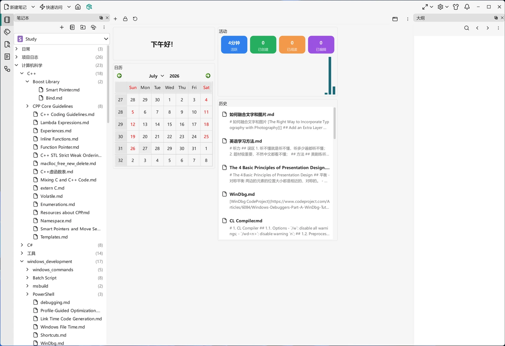

# Themes & Styles

A **theme** controls how VNote looks — the interface, the editor and read mode, and the syntax highlighting of code blocks. VNote ships with several themes, and because a theme is just a folder of files, you can copy one and tweak it to make VNote your own.

## Themes

A theme corresponds to a folder inside the `themes` folder. Switch themes through **Settings → Themes** on the main toolbar, or manage appearance in the Settings tab. See [Settings](settings.md) for where the configuration and theme folders live.

{ .screenshot loading=lazy }

### Light themes and live switching

The built-in light themes include **Pink Shock**, **Lucius**, **Dreamy**, and **Jadeite**. Lucius uses a restrained light palette, while Jadeite combines linen and teal. Dreamy now uses a Phycat Mauve-inspired light palette with lavender surfaces, plum accents, and rounded gradient headings; its editor and reader syntax colors are coordinated with the interface.

The **Native** theme follows system text colors for content, including mind maps. Switching themes refreshes Markdown code-block and math syntax colors in already-open notes without reopening them or discarding drafts, selection, or Undo/Redo history. Encrypted Markdown previews also follow the bundled theme styles; see [Encrypted Notes](../managing-notes/encrypted-notes.md) for their restrictions.

In VNote 4.14.4, bundled themes other than **Native** use smaller tree indentation and horizontal spacing while preserving row height. Returning to Native restores the trees' original spacing. Tasks, search results, Settings, and United Entry now use expansion/collapse animations consistent with Notebooks, Tags, and Outline.

### Notebook item colors { #notebook-item-colors }

To color a note or folder in notebook navigation, use its context menu **Mark → Text** or **Mark → Background**. These menus replace the old Mark dialog and each offer 12 color swatches. **Auto** clears only the selected text or background override; it does not reset the other color. These are notebook-item colors, not formatting for topics on a mind-map canvas.

### LaTeX Light and LaTeX Dark

Two of the built-in themes, **LaTeX Light** and **LaTeX Dark**, aim for a paper-and-ink look: serif body text with a capped line measure, headings distinguished by weight rather than size alone, booktabs-style tables with no vertical rules or zebra stripes, and boxed blockquotes. They cover the Markdown viewer, the editor and export, so a note looks the same on screen and on paper.

No fonts are bundled with them. They fall back to fonts you already have, and installing **Latin Modern** — plus **Noto Serif CJK** if you write Chinese — gives the intended result.

### Add a theme

The easiest way to start is from an existing theme:

1. Copy the folder of a theme you like.
2. Paste it into the `themes` folder under your **user configuration** folder.
3. Rename the folder — this becomes the theme's name.

Then edit the files inside to taste.

### What's in a theme

Key files of a theme:

- `palette.json` — the theme's palette; defines colors reused throughout the theme.
- `interface.qss` — a [Qt Style Sheet](http://doc.qt.io/qt-5/stylesheet-reference.html) that styles every widget; it uses the colors from `palette.json`.
- `text-editor.theme` — the theme of the text editor (and Markdown editor).
- `web.css` — the style sheet for Markdown **read mode**.
- `highlight.css` — read-mode code-block syntax highlighting (VNote uses [Prism](https://prismjs.com/) in read mode).
- `icons/` — optional folder of custom icons.

## Customizing fonts

### Read mode

Read-mode fonts are set in `web.css`. Body text uses `font-family` and `font-size` on `body`:

```css
body {
    font-family: -apple-system, "Noto Sans", "Segoe UI", sans-serif;
    font-size: 16px;
    line-height: 1.5;
}
```

Code fonts are set on `code` and `pre code`:

```css
code {
    font-family: Consolas, Monaco, Monospace, Courier;
}
```

Syntax-highlighted code blocks are styled in `highlight.css` (the `code[class*="language-"]` / `pre[class*="language-"]` rules).

### Text and Markdown editor

Editor fonts are set in `text-editor.theme`. Set `font-family` and `font-size` under the editor's `Text` style:

```json
{
    "editor-styles": {
        "Text": {
            "font-family": "Consolas, Monaco, Monospace, Courier New",
            "font-size": 12
        }
    }
}
```

There is a parallel `markdown-editor-styles` block for the Markdown editor.

### Interface fonts

To change interface fonts (menus, trees), edit `interface.qss` with Qt Style Sheet rules. The [Qt docs](https://doc.qt.io/qt-5/stylesheet-examples.html) have many examples.

```css
QWidget { font-size: 12pt; }

QTreeView, QListView { font-size: 12pt; }

vnotex--NotebookNodeExplorer QTreeView { font-size: 14pt; }
```

## Customizing icons

Put icon files in a theme's `icons` folder to override VNote's icons. For the full list of icon file names, see the [icons in the VNote source](https://github.com/vnotex/vnote/tree/v4.14.4/src/data/core/icons).

A typical theme directory:

```
.
├── cover.png          (optional)
├── highlight.css
├── icons
│   ├── ***.svg
│   └── ***.svg
├── interface.qss
├── palette.json
├── text-editor.theme
└── web.css
```

Some commonly replaced icons:

- **Notes:** `folder_node.svg` (folder), `file_node.svg` (note).
- **Top menu bar:** `new_note.svg`, `quick_access_menu.svg`, `united_entry.svg`, `expand.svg`, `settings.svg`, `task_dock.svg`, `split_menu.svg`, `search.svg`, `menu.svg`.
- **Left navigation bar:** `navigation_dock.svg`, `history_dock.svg`, `tag_dock.svg`, `search_dock.svg`, `snippet_dock.svg`.

## Applying export styles { #applying-export-styles }

Markdown read-mode rendering and syntax styles also drive [export](../productivity/export.md); select different styles in the export dialog or use **Follow Theme** to choose the active theme's styles. Available controls depend on the source type: native Typst and mind-map output do not use the Markdown rendering-style controls.

Since [VNote 4.13](https://github.com/vnotex/vnote/releases/tag/v4.13.0), a separate shared `web/css/export.css` lives under your **user configuration** folder, not inside an individual theme. In the export dialog's HTML options, **Apply custom styles** enables it and **Edit** opens the file. **Save the stylesheet before exporting**; VNote reads the saved file. Existing user styles are preserved across upgrades.

This stylesheet applies to exported HTML and HTML inputs used for PDF or Custom conversion. It does **not** style native Typst PDF, source copies, or custom commands that receive original source files. Specify native Typst PDF page layout and typography in the Typst source instead. The **Apply custom styles** choice is shared across these HTML-based routes; select it in HTML options before switching targets if needed.
