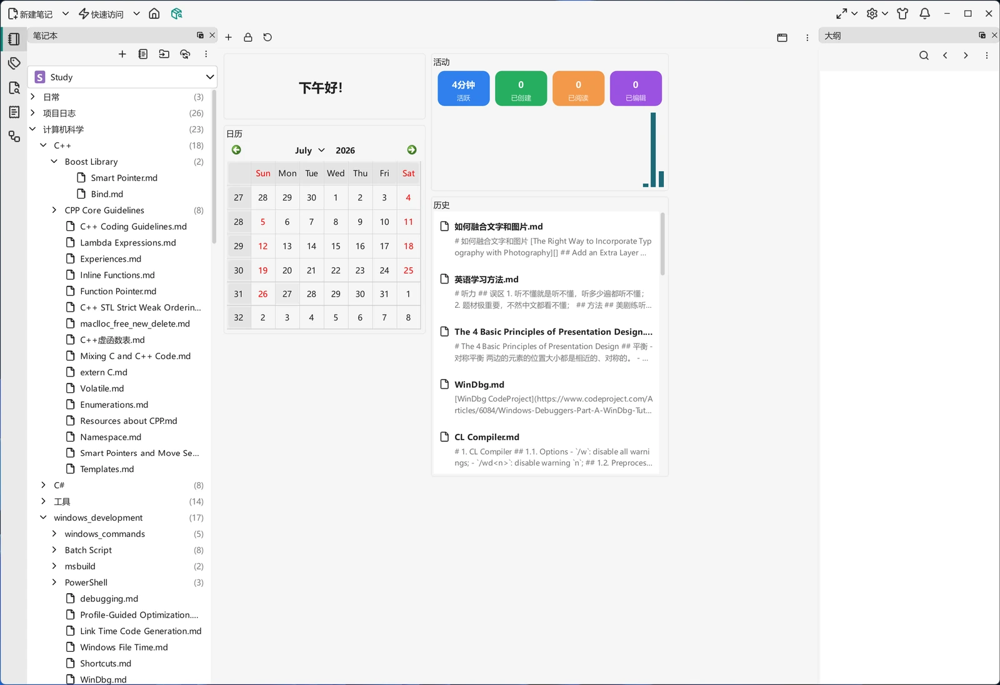

# 主题与样式

**主题**控制 VNote 的外观——界面、编辑器与阅读模式，以及代码块的语法高亮。VNote 自带若干主题，而且由于主题只是一个装着文件的文件夹，你可以复制一份并加以调整，把 VNote 变成你自己的样子。

## 主题

一个主题对应 `themes` 文件夹内的一个文件夹。通过主工具栏的**设置 → 主题**切换主题，也可以在设置标签页中管理外观。配置文件夹与主题文件夹的位置参见[设置](settings.md)。

{ .screenshot loading=lazy }

### 浅色主题与即时切换

内置浅色主题包括 **Pink Shock**、**Lucius**、**Dreamy（梦幻）**和 **Jadeite（翡翠）**。Lucius 采用柔和克制的浅色调，Jadeite 结合亚麻色与青绿色。Dreamy 现采用受 Phycat Mauve 启发的浅色调色板，搭配淡紫背景、梅紫强调色与圆角渐变标题；编辑器和阅读视图的语法颜色也与界面协调一致。

**Native** 主题的内容区域使用系统文字颜色，思维导图也不例外。切换主题会直接刷新已打开 Markdown 笔记的代码块和数学公式语法颜色，无需重新打开，也不会丢失草稿、选区或撤销/重做历史。加密 Markdown 预览同样使用内置主题样式；其限制参见[加密笔记](../managing-notes/encrypted-notes.md)。

VNote 4.14.4 中，除 **Native** 外的内置主题使用更小的树形缩进和水平间距，同时保留行高。切回 Native 会恢复树形视图原有的间距。任务、搜索结果、设置和统一入口也采用了与笔记本、标签及大纲一致的展开/折叠动画。

### 笔记本项目颜色 { #notebook-item-colors }

要为笔记本导航中的笔记或文件夹着色，请使用其右键菜单中的**标记 → 文字色（Mark → Text）**或**标记 → 背景色（Mark → Background）**。这些菜单替代旧版的标记对话框，各提供 12 种色块。**自动（Auto）**仅清除所选的文字色或背景色覆盖，不重置另一种颜色。这里设置的是笔记本项目颜色，而非思维导图画布中主题的格式。

### LaTeX Light 与 LaTeX Dark

内置主题中的 **LaTeX Light** 和 **LaTeX Dark** 追求纸墨般的观感：衬线正文并限制每行宽度、以字重而非仅靠字号区分标题、booktabs 风格的表格（没有竖线也没有斑马纹），以及带边框的块引用。它们覆盖 Markdown 阅读视图、编辑器与导出，因此笔记在屏幕上和纸上看起来一致。

这两个主题不附带任何字体。它们会回退到你系统中已有的字体；安装 **Latin Modern**——若你书写中文，再加上 **Noto Serif CJK**——即可获得预期效果。

### 添加主题

最简单的起步方式是基于现有主题：

1. 复制一个你喜欢的主题的文件夹。
2. 把它粘贴到**用户配置**文件夹下的 `themes` 文件夹中。
3. 重命名该文件夹——这将成为主题的名称。

然后按喜好编辑其中的文件。

### 主题里有什么

主题的关键文件：

- `palette.json`——主题的调色板；定义在整个主题中复用的颜色。
- `interface.qss`——一份 [Qt 样式表](http://doc.qt.io/qt-5/stylesheet-reference.html)，为每个控件设置样式；它使用 `palette.json` 中的颜色。
- `text-editor.theme`——文本编辑器（以及 Markdown 编辑器）的主题。
- `web.css`——Markdown**阅读模式**的样式表。
- `highlight.css`——阅读模式代码块的语法高亮（VNote 在阅读模式下使用 [Prism](https://prismjs.com/)）。
- `icons/`——可选的自定义图标文件夹。

## 自定义字体

### 阅读模式

阅读模式字体在 `web.css` 中设置。正文文本使用 `body` 上的 `font-family` 和 `font-size`：

```css
body {
    font-family: -apple-system, "Noto Sans", "Segoe UI", sans-serif;
    font-size: 16px;
    line-height: 1.5;
}
```

代码字体在 `code` 和 `pre code` 上设置：

```css
code {
    font-family: Consolas, Monaco, Monospace, Courier;
}
```

带语法高亮的代码块在 `highlight.css` 中设置样式（`code[class*="language-"]` / `pre[class*="language-"]` 规则）。

### 文本与 Markdown 编辑器

编辑器字体在 `text-editor.theme` 中设置。在编辑器的 `Text` 样式下设置 `font-family` 和 `font-size`：

```json
{
    "editor-styles": {
        "Text": {
            "font-family": "Consolas, Monaco, Monospace, Courier New",
            "font-size": 12
        }
    }
}
```

Markdown 编辑器有一个对应的 `markdown-editor-styles` 块。

### 界面字体

要更改界面字体（菜单、树），用 Qt 样式表规则编辑 `interface.qss`。[Qt 文档](https://doc.qt.io/qt-5/stylesheet-examples.html)提供了许多示例。

```css
QWidget { font-size: 12pt; }

QTreeView, QListView { font-size: 12pt; }

vnotex--NotebookNodeExplorer QTreeView { font-size: 14pt; }
```

## 自定义图标

把图标文件放进主题的 `icons` 文件夹即可覆盖 VNote 的图标。图标文件名的完整列表参见 [VNote 源码中的 icons](https://github.com/vnotex/vnote/tree/v4.14.4/src/data/core/icons)。

一个典型的主题目录：

```
.
├── cover.png          （可选）
├── highlight.css
├── icons
│   ├── ***.svg
│   └── ***.svg
├── interface.qss
├── palette.json
├── text-editor.theme
└── web.css
```

一些常被替换的图标：

- **笔记：**`folder_node.svg`（文件夹）、`file_node.svg`（笔记）。
- **顶部菜单栏：**`new_note.svg`、`quick_access_menu.svg`、`united_entry.svg`、`expand.svg`、`settings.svg`、`task_dock.svg`、`split_menu.svg`、`search.svg`、`menu.svg`。
- **左侧导航栏：**`navigation_dock.svg`、`history_dock.svg`、`tag_dock.svg`、`search_dock.svg`、`snippet_dock.svg`。

## 应用导出样式 { #applying-export-styles }

Markdown 阅读模式的渲染与语法样式也驱动[导出](../productivity/export.md)；可在导出对话框中选择其他样式，或使用**跟随主题（Follow Theme）**选用当前主题的样式。可用控件取决于源类型：原生 Typst 和思维导图输出不使用 Markdown 渲染样式控件。

自 [VNote 4.13](https://github.com/vnotex/vnote/releases/tag/v4.13.0) 起，**用户配置**文件夹下提供独立、共享的 `web/css/export.css`，它不属于某个主题目录。在导出对话框的 HTML 选项中，**应用自定义样式（Apply custom styles）**启用该文件，**编辑（Edit）**打开它。**导出前请保存样式表**；VNote 读取的是已保存的文件。升级时会保留已有的用户样式。

该样式表用于导出的 HTML，以及 PDF 或自定义转换的 HTML 输入。它**不**影响原生 Typst PDF、源文件副本，或接收原始源文件的自定义命令。原生 Typst PDF 的页面布局和字体排版应在 Typst 源码中指定。**应用自定义样式**的选择由这些基于 HTML 的流程共享；如有需要，先在 HTML 选项中设置，再切换目标。
