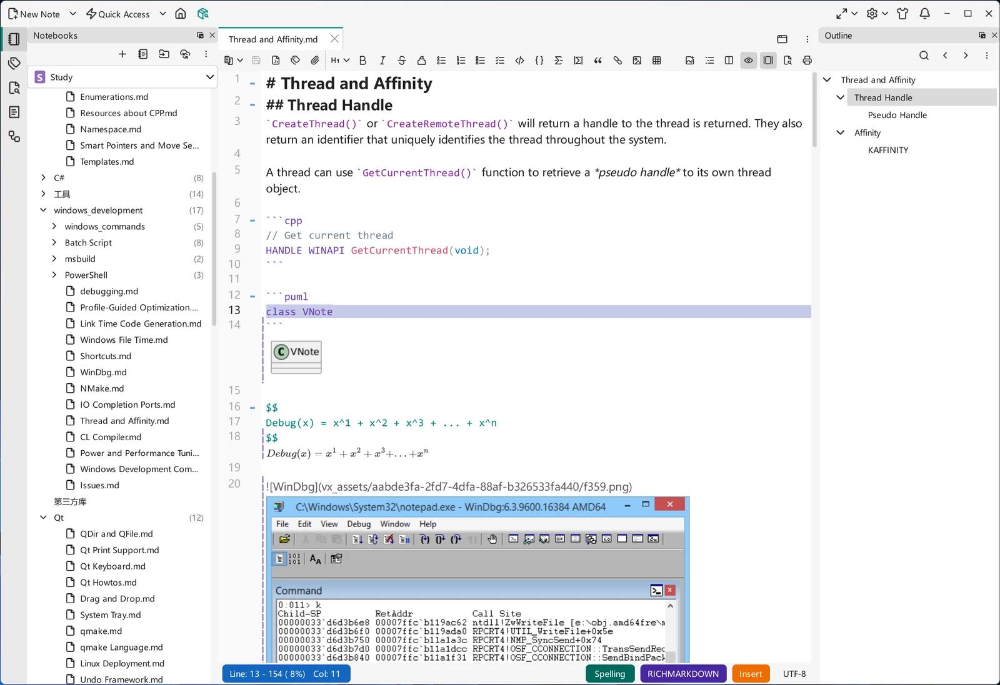
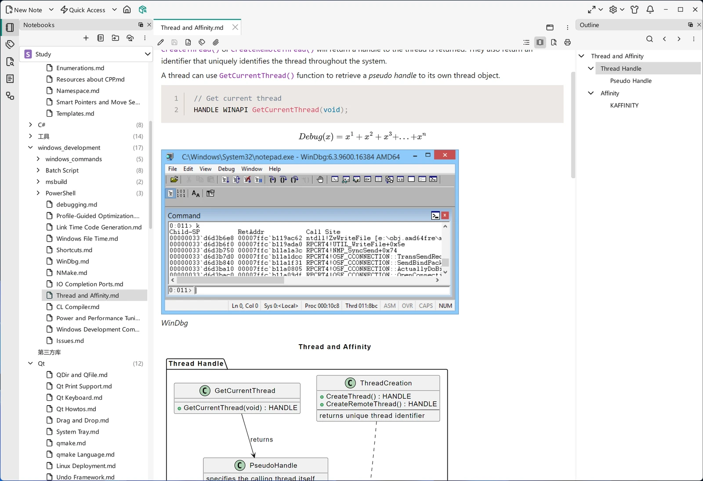
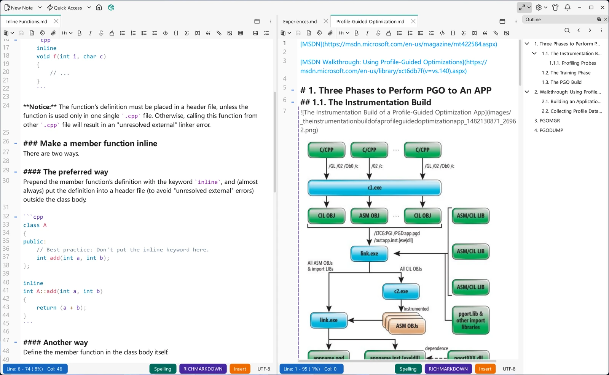
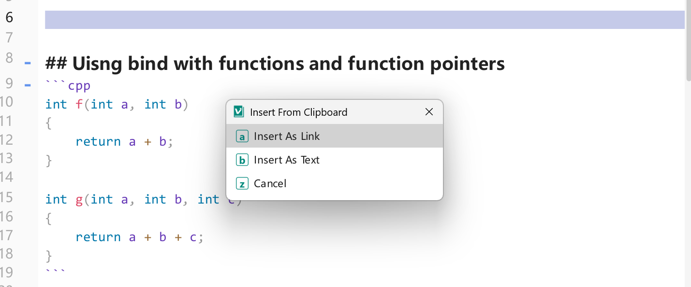

# 编辑器基础

编辑器是你花时间最多的地方，因此它的设计让 Markdown 用起来自然顺手：写作时你能把握内容，阅读时又能看到精美的渲染。本页介绍编辑模式、大纲、标签页与分屏，以及构成一次写作会话的日常操作。

标签页、分屏、大纲和笔记导航适用于所有编辑器，而编辑/阅读模式、实时预览以及 Cross Copy 或 Parse to Markdown 等功能则是 Markdown 编辑器特有的。

## 编辑模式与阅读模式

每篇笔记都以两种模式之一打开：

- **编辑模式**显示你的 Markdown 源码，并带有丰富的**语法高亮**。标题、强调、链接、代码等元素就地着色，因此无需单独的预览，文本依然易读。这正是 VNote 对常见「编辑与预览」割裂问题的回答——参见[为什么选择 VNote](../getting-started/why-vnote.md)。
- **阅读模式**将笔记渲染为最终的排版形式，便于舒适地阅读与分享。

从编辑器工具栏或用模式快捷键在两者间切换。导出也基于阅读模式——参见[导出](../productivity/export.md)。

{ .screenshot loading=lazy }

{ .screenshot loading=lazy }

## 实时预览

在编辑模式下，VNote 无需切到阅读模式即可预览富元素：

- **原位预览**把图片、数学公式、图表和表格等元素直接渲染在编辑器内、它们在文本中出现的位置。原位预览会随编辑器一同缩放；预览出现时其源码块会自动折叠——如果你手动展开，VNote 会尊重这一选择，不再自动折叠。
- **并排预览**在编辑器旁打开一个渲染面板，随你输入同步滚动，适合你希望一边写作一边看到完整结果时使用。

按笔记的需要选用；并排预览可随时开启或关闭。

**交互式表格预览**默认启用：Markdown 表格会以可直接编辑的表格形式预览，单元格带语法高亮，可从其**表格**菜单进行行、列与对齐操作，在最后一个单元格按 `Enter` 还会追加一行。所有编辑都会写回 Markdown 源码。

**设置 → Markdown 编辑器**下有两个选项用于控制写回后的格式以及预览对源码的影响。**对齐表格源码（Align table source）**会把通过预览编辑的表格格式化为按列对齐的管道表格；已有表格只有在你编辑后才会重新格式化。**自动折叠已预览的块（Auto fold previewed blocks）**会在原位预览出现时折叠该块的源码；它要求启用文本折叠，关闭此选项也不会展开已经折叠的块。

大型笔记会渐进式渲染预览。屏幕外的表格会保留布局空间，仅在需要时构建；可见的图表预览会优先处理，阅读模式中的图表也会逐步显示。对于极端文档，表格单元格的语法高亮最多应用于 5000 个单元格；其余单元格和表格内容仍会正常渲染。

## 大纲

**大纲**停靠部件显示当前笔记的标题结构。它随你的写作而更新，并且完全可交互——点击任意标题即可直接跳转到该小节。在编辑模式下，它显示渲染后的标题文字而非原始 Markdown；当标签过长放不下时，面板还可以横向滚动。对于长笔记，大纲是移动位置和检查文档结构最快的方式。

## 分离窗口

视图不必一直留在主窗口中：

- 标签页右键菜单中的**分离（Detach）**（`Ctrl+G, Shift+D`）会把当前标签页移到独立的顶层窗口。
- 笔记本浏览器右键菜单中的**以分离方式打开（Open as Detached）**可直接在分离窗口中打开笔记。
- [命令行](../getting-started/command-line.md)选项 `--detached-view` 可从终端或脚本达成同样效果。

分离窗口带有**置顶（Stay on Top）**图钉（`F10`），可让它始终显示在其他窗口之上，方便你在别处工作时参考笔记或 [PDF](../managing-notes/pdf-viewer.md)。

## 主页标签页

VNote 启动时停留在[仪表盘](../getting-started/dashboard.md)主页标签页。当它是主区域中唯一的标签页时，在主区域打开文件会自动关闭它，免得留下一个无用的占位；而在分离窗口中打开文件则不会影响它。主区域再次清空时，主页标签页会重新出现。此行为无需配置。

## 重新加载

笔记可能在磁盘上发生变化——同步、其他编辑器或脚本都可能改动它。VNote 会检测到变化并重新加载缓冲区，之后光标位置会被恢复。手动重新加载、修改笔记编码，以及窗口重新获得焦点时的重新同步，同样会恢复光标位置。

## 标签页、分屏与导航

- **标签页**——笔记以标签页形式在内容区打开，你可以同时保留多篇并在它们之间切换。
- **分屏**——把内容区分成并排的多个视图，用于对比两篇笔记，或在编辑一篇时参考另一篇。
- **快速跳转**——借助大纲、[搜索](../search/index.md)、[统一入口](../search/united-entry.md)和[历史](../managing-notes/quick-access-history.md)快速移动，在大型笔记本中尤为有用。

{ .screenshot loading=lazy }

## 复制与粘贴

除了普通的复制和粘贴，Markdown 编辑器还提供若干用于在 VNote 内外搬运内容的辅助功能：

- **从剪切板插入（Insert From Clipboard）**——粘贴一个 URL 时，VNote 不会直接插入裸文本，而是询问你希望以何种方式插入。**插入为链接**会把它包装成 Markdown 链接，**插入为文本**则原样粘贴；当该 URL 指向图片、本地文件，或可作为附件添加到笔记的文件时，还会出现更多选项。
- **交叉复制（Cross Copy）**——在**阅读模式**下，选中已渲染的内容，从右键菜单中使用**交叉复制**，即可将其作为针对特定目标应用优化过的富文本复制。VNote 会按目标改写底层 HTML——可选项包括**无背景**、**Evernote**、**OneNote**、**Microsoft Word**、**微信公众号编辑器**和**原始 HTML**——从而在粘贴到该应用时保留格式。
- **解析为 Markdown 并粘贴（Parse to Markdown and Paste）**——当剪贴板中含有 HTML（例如从网页复制的内容）时，从编辑器的右键菜单中使用**解析为 Markdown 并粘贴**（默认 `Ctrl+G, Ctrl+P`），即可把该 HTML 转换为 Markdown 并插入。如果在[设置](../customization/settings.md)中启用了**在“解析为 Markdown 并粘贴”时将图片抓取到本地**，粘贴内容中的远程图片会被下载到笔记的附件中，并改写其链接。

{ .screenshot loading=lazy }

## 日常编辑

编辑器支持常见的基本功能——撤销/重做、笔记内查找与替换、复制/粘贴——以及你将在后续页面见到的 VNote 专属加速器：

- [Markdown 语法](markdown-syntax.md)：VNote 能识别的格式。
- [图片与图床](images-and-image-host.md)：粘贴与管理图片。
- [数学与图表](math-and-diagrams.md)：公式与图表。
- [片段](snippets.md)与[模板](templates.md)：避免重复输入。
- [Vi 模式](vi-mode.md)：模式化、以键盘驱动的编辑。

几乎每个操作都有键盘快捷键；参见[键盘快捷键](../customization/keyboard-shortcuts.md)，让双手无需离开键盘。
