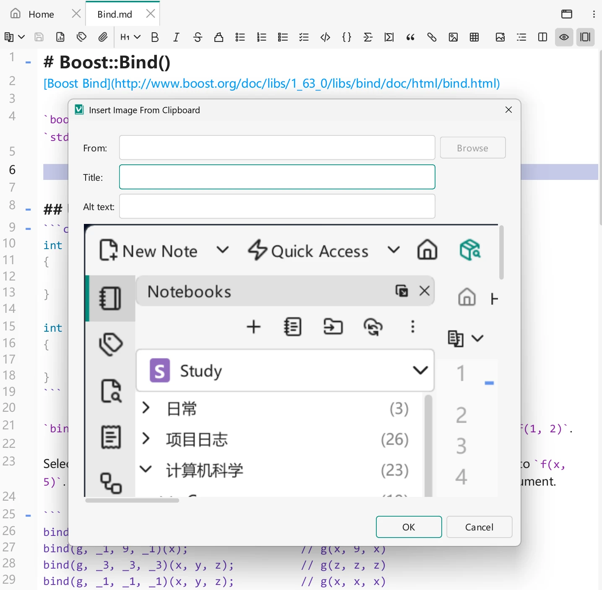

# 图片与图床

笔记常常需要配图，而 VNote 让插图变得毫不费力：粘贴一张图片，它就会被保存进笔记本并自动生成链接。当你想分享纯 Markdown 文件却不想附带图片文件时，**图床**会把你的图片改为存放在网络上。

## 插入图片

将截图或复制的图片粘贴进编辑器，或使用**插入图片**。对话框提供两种选择：

- **图片文件（Image file）**保存独立图片文件并插入链接。本地存储时，图片进入笔记本的资源目录——默认为笔记本根目录下 `vx_assets` 中按笔记划分的子文件夹。
- **Base64** 将图片数据嵌入 Markdown 正文，使用参考式图片链接和 data URI 定义，无需单独的图片文件；此方式不启用自定义宽高输入框。

普通笔记默认选择**图片文件**；加密 Markdown 中 **Base64** 排在前面并默认选中。Base64 只是编码，不是加密：只有保存进[加密笔记正文](../managing-notes/encrypted-notes.md)后，嵌入的数据才受保护。独立图片文件及上传到图床的图片不受笔记加密保护。

**设置 → 编辑器 → 默认图片格式（Default image format）**控制剪贴板图片保存为文件时的格式：**JPEG**（默认）将透明区域合成到白色背景上；**PNG** 保留透明度。原始文件和 URL 保留其格式，Base64 插入仍为无损方式。

你也可以从文件插入图片，或将图片拖放进编辑器。由于图片存放在笔记本内，当你复制或[同步](../managing-notes/notebook-sync.md)笔记本时，它们会随之一起迁移。

{ .screenshot loading=lazy }

```md

```

## 图片尺寸

图片默认按原始尺寸插入，但你也可以为它指定尺寸。**插入图片**对话框提供可选的 **Width (px)** 与 **Height (px)** 输入框；它们默认为空，并以图片的原始尺寸作为占位提示，因此只填其中一个也可以。

对于笔记中已有的图片，在编辑模式下右键点击它；图片操作现已直接显示在右键菜单中：

- **查看图片（View Image）**单独打开该图片。
- **复制图片（Copy Image）**把本地图片复制到剪贴板；对于在线图片，该项为**复制原位预览（Copy In-Place Preview）**，复制原位预览所显示的内容。
- **复制图片地址（Copy Image Address）**复制链接目标。
- **调整图片尺寸（Resize Image）**打开宽高对话框，并提供**缩放（Scale (%)）**滑块。`100%` 表示当前尺寸；移动滑块会按比例同时调整宽高。手动修改尺寸后，新尺寸成为缩放基准。若无法获取尺寸，输入宽高即可启用缩放；VNote 不会仅为调整尺寸而下载远程图片。

VNote 会尽量以最小的改动改写链接：

- 被设置了尺寸的 Markdown 图片会改写为 `` 标签，因为 Markdown 本身无法表达尺寸。
- 清空以 `=WxH` 后缀书写的 Markdown 链接的尺寸后，它会恢复为普通 Markdown。
- 已有的 HTML `` 会就地修改。填入 `0` 表示移除该维度；只有当结果能干净地往返转换时，VNote 才会把标签转回 Markdown。
- `class`、`style`、`data-*` 等手写属性会被保留。

## 遗留图片文件夹

旧版 VNote 创建的笔记会把图片放在 `vx_images` 或 `_v_images` 文件夹中，而不是附件文件夹。打开这类笔记时，会出现一个内嵌横幅提示你整理它们：**迁移到附件文件夹（Migrate to Assets Folder）**、**暂不（Not Now）**或**不再询问（Don't Ask Again）**。

迁移会移动磁盘上的文件。如果其他笔记也链接到共享遗留文件夹中的同一张图片，那些链接会失效——因此请把相关笔记一起迁移，或者干脆保持原样。这些文件夹与笔记本结构的关系参见[笔记本、文件夹与笔记](../managing-notes/notebooks-folders-notes.md)。

## 本地图片与图床

对于存放在笔记正文之外的图片，你可以在编辑器中选择本地存储或图床：

- **本地图片**——文件存放在笔记本内。自包含且适合离线。
- **图床**——图片上传到在线服务，笔记链接到在线 URL。此时 Markdown 文件不再引用任何本地文件，因此你可以分享纯文本，读者在任何地方都能看到图片。

网络不佳时的一个实用流程：写作时先**本地**插入图片，最后再把笔记中的**所有图片一并上传**到图床。

## 什么是图床

**图床**是一个在线保存你图片的服务。与本地图片不同，使用图床的笔记本身不携带任何图片文件——你可以只把 Markdown 文本交给别人，他们依然能看到每一张在线加载的图片。

## 配置图床

首先在**设置**中配置图床。VNote 支持三种图床类型——**GitHub 仓库**、**Gitee 仓库**和**自定义命令（Custom Command）**——然后在编辑器中选择使用本地图片或图床。

### GitHub / Gitee

Gitee 的流程与之类似；这里以 GitHub 为例。

1. 在 GitHub 中进入 **Settings → Developer settings**，生成一个新的 **Personal access token**。
2. 选择 **repo** 权限范围，生成令牌并复制它。
3. 创建一个**公开**仓库来存放图片。生成默认的 `README`，让仓库有一次初始提交。
4. 在 VNote 中新建图床，填入 **Personal Access Token**、**User Name** 和 **Repository Name**。

配置完成后，上传一张图片（或笔记中的所有图片）会把文件推送到该仓库，并将链接改写为它们的在线 URL。

### 自定义命令

**自定义命令**类型通过运行你定义的外部命令来上传图片，因此你可以对接任何提供命令行工具的上传器或图片服务。VNote 会把图片传给你的命令，并使用它返回的 URL。

## 编辑器如何管理图片文件

编辑器会让笔记的本地图片文件与其内容保持一致，因此你很少需要亲自去动附件文件夹：

- **清理未使用的图片。** 当你关闭一篇笔记的最后一个视图时，VNote 会删除该笔记不再引用的本地图片文件——包括打开时就存在、或本次会话中插入但随后被删除的图片。这可以避免附件文件夹被无用文件塞满。对**图床**上未使用图片的清理是可选的，由[设置](../customization/settings.md)中的**清理图床上未使用的图片（仅基于当前文件）**控制。
- **粘贴时复制被链接的图片。** 当你粘贴的文本中含有指向现有本地图片的相对链接（例如从另一篇笔记搬来的内容）时，VNote 会询问是**连同链接的图片一起粘贴**还是**作为纯文本粘贴**。选择*连同链接的图片一起粘贴*会把每个被引用的图片复制到当前笔记的附件中并改写链接，使其在新位置依然有效；对同一来源的重复引用只会复制一次，并会有一个汇总告知复制或跳过了多少个。

## 小贴士

- 妥善保管令牌——把个人访问令牌当作密码对待。
- 追求可携带、离线的笔记就用本地图片；用于公开分享则用图床。
