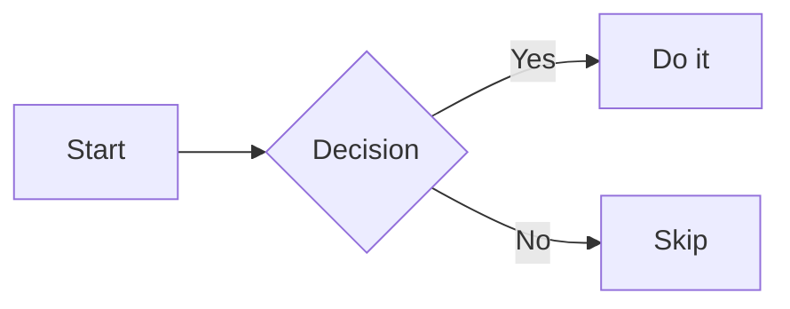
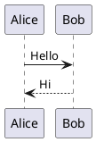
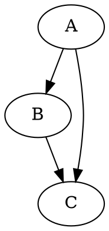

# Math & Diagrams

VNote renders mathematical formulas and several kinds of diagrams directly from your Markdown, so technical notes stay readable in the editor and beautiful in read mode. Everything is written as plain text in fenced blocks — nothing is stored as a binary image.

## Math formulas

VNote uses **KaTeX** by default to typeset LaTeX math. KaTeX, its fonts, and the preview rasterizer are bundled, so reading, editor previews, and exports work offline. **Settings → Markdown Editor → Math renderer** lets you choose **KaTeX** or **MathJax**.

- **Inline** math goes between single dollar signs: `$E = mc^2$`.
- **Block** (display) math goes in a `$$ … $$` block:

```md
$$
\int_{a}^{b} f(x)\,dx = F(b) - F(a)
$$
```

Math renders in read mode and in the editor's in-place and side-by-side previews (see [Editor Basics](editor-basics.md)).

For [encrypted notes](../managing-notes/encrypted-notes.md), protected read and side-by-side previews always use bundled KaTeX; in-place math previews remain unavailable.

### Customizing MathJax {#customizing-mathjax}

Select **MathJax** under **Math renderer** to enable **Override MathJax script** in the same settings page. Enter the script URL for your chosen MathJax build, or a local file URL such as `file:///C:/Users/foo/mathjax/tex-svg.js` for an installed offline copy with its required resources. Leave the field empty to use the default script. There is no need to copy and edit VNote’s `web/js/mathjax.js` just to change this URL. See also the [FAQ](../help/faq.md#custom-mathjax).

## Diagrams

VNote renders diagrams from fenced code blocks using several diagram engines. Write the diagram in its own language and VNote turns it into a rendered figure.

### Mermaid

````md

````

### PlantUML

````md

````

**Settings → Markdown Editor → PlantUml** chooses **Web service** or **Local JAR**; local rendering requires Java and a PlantUML JAR. **PlantUml format** selects **SVG** (default) or **PNG** for read mode and exports; editor previews always use PNG. Sequence diagrams containing `newpage` show each page in read mode and stack the pages into one editor-preview image, without changing the source.

### Graphviz (DOT)

````md

````

Graphviz accepts `dot`/`graphviz` and engine-named fences: `neato`, `twopi`, `circo`, `fdp`, `sfdp`, `patchwork`, and `osage`. **Settings → Markdown Editor → Graphviz** selects **Web service** or **Local executable**; configure the Graphviz executable for local rendering. The `sfdp` engine requires local Graphviz. Other flow/graph formats are supported as well.

## Requirements and settings

- **KaTeX** and **Mermaid** render locally out of the box. MathJax availability depends on the selected script and its resources.
- For **PlantUML** and **Graphviz**, choose local tools when you need offline rendering; check the engine options and required paths in [Settings](../customization/settings.md) if a diagram fails.

Because diagrams and math are plain text, they diff cleanly under version control and export together with your note — see [Export](../productivity/export.md).
