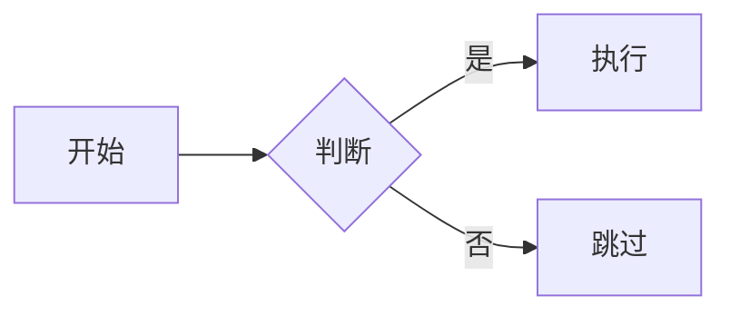

# 数学与图表

VNote 能直接从你的 Markdown 渲染数学公式和多种图表，让技术笔记在编辑器中保持易读、在阅读模式中精美呈现。这一切都以纯文本形式写在围栏代码块中——没有任何内容被存为二进制图片。

## 数学公式

VNote 默认使用 **KaTeX** 排版 LaTeX 数学公式。KaTeX、字体及预览栅格化组件均已内置，因此阅读、编辑器预览和导出可离线使用。**设置 → Markdown 编辑器 → 数学公式渲染器（Math renderer）**可选择 **KaTeX** 或 **MathJax**。

- **行内**公式放在一对美元符号之间：`$E = mc^2$`。
- **块级**（独立显示）公式放在 `$$ … $$` 块中：

```md
$$
\int_{a}^{b} f(x)\,dx = F(b) - F(a)
$$
```

数学公式会在阅读模式以及编辑器的原位预览和并排预览中渲染（参见[编辑器基础](editor-basics.md)）。

对于[加密笔记](../managing-notes/encrypted-notes.md)，受保护的阅读和并排预览始终使用内置 KaTeX；原位数学预览仍不可用。

### 自定义 MathJax {#customizing-mathjax}

在**数学公式渲染器**中选择 **MathJax**，即可启用同一设置页中的**覆盖 MathJax 脚本（Override MathJax script）**。输入所选 MathJax 构建的脚本 URL；若已安装离线副本及其所需资源，也可填写本地文件 URL，例如 `file:///C:/Users/foo/mathjax/tex-svg.js`。留空即使用默认脚本。仅更换此 URL 无需复制并修改 VNote 的 `web/js/mathjax.js`。另见[常见问题](../help/faq.md#custom-mathjax)。

## 图表

VNote 使用多种图表引擎，从围栏代码块渲染图表。用各自的语言编写图表，VNote 会将其转换为渲染后的图形。

### Mermaid

````md

````

### PlantUML

````md
```plantuml
@startuml
Alice -> Bob: 你好
Bob --> Alice: 嗨
@enduml
```
````

**设置 → Markdown 编辑器 → PlantUml**可选择**网络服务（Web service）**或**本地 JAR（Local JAR）**；本地渲染需要 Java 和 PlantUML JAR。**PlantUml 格式（PlantUml format）**可选择阅读模式与导出使用 **SVG**（默认）或 **PNG**；编辑器预览始终使用 PNG。含 `newpage` 的序列图在阅读模式下显示各页，在编辑器预览中将各页上下拼接成一张图片，不改动源码。

### Graphviz（DOT）

````md
```dot
digraph G {
    A -> B;
    B -> C;
    A -> C;
}
```
````

Graphviz 支持 `dot`/`graphviz`，也支持以引擎命名的围栏：`neato`、`twopi`、`circo`、`fdp`、`sfdp`、`patchwork` 和 `osage`。**设置 → Markdown 编辑器 → Graphviz**可选择**网络服务（Web service）**或**本地可执行文件（Local executable）**；本地渲染需配置 Graphviz 可执行文件。`sfdp` 引擎要求使用本地 Graphviz。其他流程图/图形格式同样受支持。

## 依赖与设置

- **KaTeX** 和 **Mermaid** 开箱即可本地渲染。MathJax 是否可用取决于所选脚本及其资源。
- **PlantUML** 和 **Graphviz** 需要离线渲染时，请选择本地工具；若图表无法渲染，请在[设置](../customization/settings.md)中检查引擎选项与所需路径。

由于图表和数学都是纯文本，它们在版本控制下能干净地对比差异，并与笔记一起导出——参见[导出](../productivity/export.md)。
