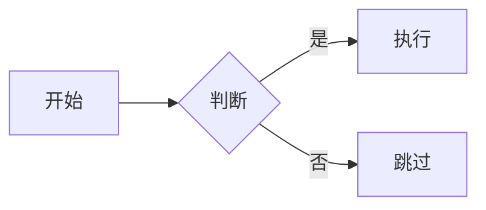
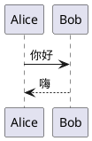
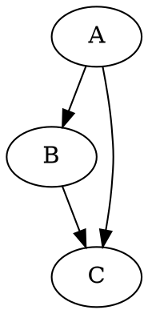

# 数学与图表

VNote 能直接从你的 Markdown 渲染数学公式和多种图表，让技术笔记在编辑器中保持易读、在阅读模式中精美呈现。源码始终是纯文本：公式使用美元符号分隔符，图表使用围栏块。

## 数学公式

VNote 默认使用 **KaTeX** 排版 LaTeX 数学公式。KaTeX、字体及预览栅格化组件均已内置，因此阅读、编辑器预览和导出可离线使用。**设置 → Markdown 编辑器 → 数学公式渲染器（Math renderer）**可选择 **KaTeX**、**MathJax** 或 **Typst**。以下示例采用适用于 KaTeX/MathJax 的 LaTeX 语法。

- **行内**公式放在一对美元符号之间：`$E = mc^2$`。
- **块级**（独立显示）公式放在 `$$ … $$` 块中：

```md
$$
\int_{a}^{b} f(x)\,dx = F(b) - F(a)
$$
```

数学公式会在阅读模式以及编辑器的原位预览和并排预览中渲染（参见[编辑器基础](editor-basics.md)）。

对于[加密笔记](../managing-notes/encrypted-notes.md)，经过授权的阅读和并排预览在选中 **Typst** 时使用 Typst，否则使用内置 **KaTeX**。**Typst 是受保护笔记唯一支持的原位数学公式渲染器**；这一例外不会解除受保护笔记的其他限制，也不会绕过解锁与授权。

### Typst 数学公式 { #typst-math }

在**数学公式渲染器**中选择 **Typst**，即可使用内置原生运行时。仍然使用 `$…$` 和 `$$…$$` 分隔符，但其中应编写 **Typst 数学语法**，而非 LaTeX。更换渲染器不会自动翻译已有公式。例如：

```md
行内公式：$frac(a, b)$

$$
integral_a^b f(x) dif x = F(b) - F(a)
$$
```

Typst 数学公式支持原位与实时预览。普通 Markdown 笔记也支持自包含的 HTML/PDF 导出以及交叉复制；受保护笔记的导出与复制限制仍然适用。若需要完整排版文档，而非 Markdown 中的公式，请创建[原生 Typst 笔记](typst.md)。

### Typst 围栏块 { #fenced-typst-blocks }

`typst` 围栏独立于**数学公式渲染器**来渲染 Typst 标记——即使选择 KaTeX 或 MathJax 也可使用：

````md
```typst
#set page(width: 8cm, height: 4cm, margin: 0.5cm)
= A Typst block
$ frac(a, b) $
```
````

块会在预览、导出和交叉复制中保留作者指定的页面尺寸与多页输出。嵌入 Markdown 的块会去掉 Typst 默认页边距，以便与周围内容对齐；上例这样的显式页边距会保留。独立 `.typst` 文档的布局不受影响。

### 自定义 MathJax {#customizing-mathjax}

在**数学公式渲染器**中选择 **MathJax**，即可启用同一设置页中的**覆盖 MathJax 脚本（Override MathJax script）**。输入所选 MathJax 构建的脚本 URL；若已安装离线副本及其所需资源，也可填写本地文件 URL，例如 `file:///C:/Users/foo/mathjax/tex-svg.js`。留空即使用默认脚本。仅更换此 URL 无需复制并修改 VNote 的 `web/js/mathjax.js`。另见[常见问题](../help/faq.md#custom-mathjax)。

## 图表

VNote 使用多种图表引擎，从围栏代码块渲染图表。用各自的语言编写图表，VNote 会将其转换为渲染后的图形。

### Mermaid

````md

````

### PlantUML

````md

````

**设置 → Markdown 编辑器 → PlantUml**可选择**网络服务（Web service）**或**本地 JAR（Local JAR）**；本地渲染需要 Java 和 PlantUML JAR。**PlantUml 格式（PlantUml format）**可选择阅读模式与导出使用 **SVG**（默认）或 **PNG**；编辑器预览始终使用 PNG。含 `newpage` 的序列图在阅读模式下显示各页，在编辑器预览中将各页上下拼接成一张图片，不改动源码。

### Graphviz（DOT）

````md

````

Graphviz 支持 `dot`/`graphviz`，也支持以引擎命名的围栏：`neato`、`twopi`、`circo`、`fdp`、`sfdp`、`patchwork` 和 `osage`。**设置 → Markdown 编辑器 → Graphviz**可选择**网络服务（Web service）**或**本地可执行文件（Local executable）**；本地渲染需配置 Graphviz 可执行文件。`sfdp` 引擎要求使用本地 Graphviz。其他流程图/图形格式同样受支持。

## 依赖与设置

- **KaTeX**、**Typst** 和 **Mermaid** 开箱即可本地渲染。MathJax 是否可用取决于所选脚本及其资源。
- **PlantUML** 和 **Graphviz** 需要离线渲染时，请选择本地工具；若图表无法渲染，请在[设置](../customization/settings.md)中检查引擎选项与所需路径。

由于图表和数学都是纯文本，它们在版本控制下能干净地对比差异，并与笔记一起导出——参见[导出](../productivity/export.md)。
