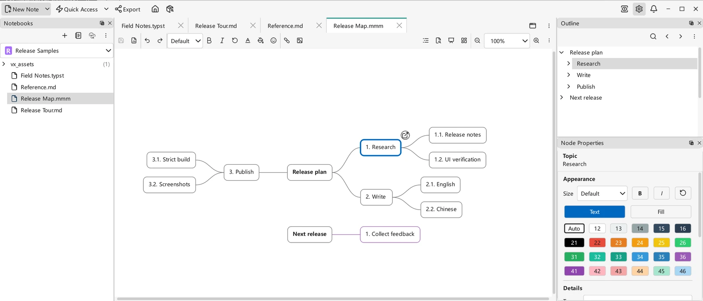

# Mind Maps

Beyond Markdown, VNote supports **mind maps** as a first-class note type. A mind map is its own kind of note — created, edited, and stored inside a notebook just like a Markdown note — that you build visually as a tree of connected nodes rather than writing as text.

## Mind maps are their own note type

In VNote a mind map is **not** a rendering of a Markdown document; it is a distinct file type opened in the native **m3 mind-map editor**. The preferred built-in extension is now `.mmm`; `.emind` remains supported, and existing custom suffix settings are preserved. Mind maps sit alongside Markdown notes in the same notebook, folder tree, and navigation panel.

Because a mind map is a real note, everything you know about [managing notes](../managing-notes/notebooks-folders-notes.md) applies: it lives inside the Notebook Root Folder, travels with the notebook when you copy or [sync](../managing-notes/notebook-sync.md) it, and can be organized in folders.

## Creating a mind map

Create a mind map through **New Note** and choose **Mind Map** instead of Markdown. With the default suffix settings, VNote creates an `.mmm` note. The bundled `title.mmm` [template](templates.md) uses the note title as the central topic; existing template choices are preserved. An empty map without a template opens with a **Central topic** ready to edit.

## Editing a mind map

The mind-map editor is a visual, node-based canvas: you add child and sibling nodes, connect and rearrange them, and build out branches to structure ideas radially. This makes mind maps well suited to brainstorming, planning, and outlining relationships that are awkward to express as a linear document.

{ .screenshot loading=lazy }

VNote 4.12.0 on Windows with the English interface: numbered branches, an independent tree, and the **Node Properties** panel in the Tools dock. This illustration uses a separate synthetic sample map, not the demo notebook.

The native editor includes node formatting, links, images, Find, an outline, and Undo/Redo. Folding a branch changes only the current editor's view, not the saved map or another open view; folding and expanding preserve node positions.

### Building and navigating branches

- Add child and sibling nodes, or create an **independent tree** on the empty canvas. Use the **Layout** menu to change the arrangement; VNote remembers the default layout for new maps.
- Duplicate an entire branch, or use node **Copy** and **Paste** to reuse it. Pasted nodes receive fresh IDs while retaining properties and internal links, and the operation can be undone in one step.
- Right-click a node for **Expand All** or **Collapse All** to show or hide its descendants recursively, including in read-only maps. Hover over a branch to reveal its expand/collapse control.
- Double-click a topic or blank node space to edit it, including an empty topic. Images and expand/collapse controls keep their own actions.
- Use `Ctrl+H`, `Ctrl+J`, `Ctrl+K`, and `Ctrl+L` for directional node navigation. **Shortcuts Help** is available from both node and empty-canvas context menus. In node properties, `Alt+M` opens **Image** and `Alt+I` opens **Icons**.

### Images, links, icons, and tags

Insert images or hyperlinks through the toolbar, node context menu, clipboard, or drag-and-drop. Adding a link preserves the existing topic text, and inserting a batch is one undoable operation. Node context menus also provide icon and tag inputs and **Copy Link** for a node URL.

Right-click a node image to view it in a zoomable overlay, copy the image or its source address, or resize it with Undo support. See [Images & Image Host](images-and-image-host.md#viewing-images).

External-link warnings share the persistent **Never Ask** preference with Markdown and Typst. This does not disable separate local-file warnings or bypass protected-note authorization.

### Node properties and the Tools dock

By default, node properties appear in the **Tools** dock, whose title and contents follow the active view. To keep them inside the editor instead, turn off **Settings → Editor → Mind Map Editor → Separate node properties panel**. Applying the setting moves the panel immediately without reopening the map or losing edits. Detached windows always keep properties embedded, without changing the main-window preference. Collapsing the embedded panel is separate from showing or hiding the Tools dock through **View → Windows List**.

### Zoom and presentation

VNote remembers fixed zoom percentages or **Fit** mode in session state. The toolbar offers zoom out/in, **Fit**, and **100%**, **125%**, **150%**, and **200%** presets. To use another scale, type a positive percentage in the zoom field and press `Enter`. The controls also track keyboard zoom commands and `Ctrl+wheel`.

Press `F9` (or **Presentation Mode**) to present the current map fullscreen, and `Escape` to exit. The embedded node-properties panel starts collapsed, and the toolbar fades out of the way; this is view presentation, not the application's `F11` fullscreen toggle.

### Mind-map settings

Under **Settings → Editor → Mind Map Editor**, configure:

- **Font family** and **Font size** — defaults for node text; an empty family uses the interface font, and node-specific sizes still override the default size.
- **Undo limit** — the maximum retained document commands; `0` means unlimited. Lowering the limit discards excess Undo/Redo history.
- **Confirm subtree deletion** — ask before deleting nodes and their descendants.
- **Automatic branch colors** — assign colors to new main branches without recoloring existing nodes.
- **Automatic section numbering** — number topic labels using the shared **Section Number Pattern**; the main root and independent roots remain unnumbered.
- **Separate node properties panel** — enabled by default; determines whether properties use the Tools dock as described above.

Apply settings to update open maps without reloading them, including node-properties placement. Mind-map-specific bindings live under `editor.mindMapEditor.shortcuts`; shared view shortcuts such as `PresentationMode` use `editor.core.shortcuts`. See [Settings](../customization/settings.md) and [Keyboard Shortcuts](../customization/keyboard-shortcuts.md).

## Printing and exporting

Choose **Print** from the toolbar's three-dot **Menu** to fit the current canvas layout onto one page, including text, images, links, and active inline edits. Right-click empty canvas and choose **Export** for **Markdown**, **HTML**, or **PDF** output. HTML and PDF can include readable articles for node content as well as the visual map; see [Export](../productivity/export.md#mind-map-exports).

**Current buffer** export includes unsaved editor changes. **Current note** and batch exports read saved files, so save first when you want those scopes to include your latest edits. Encrypted maps cannot be exported or printed, even when unlocked.

## Mind maps vs. Markdown outlines

- Reach for a **mind map** when you want a free-form, visual tree of ideas that you manipulate directly.
- Reach for a **Markdown note** with headings and nested lists when you want linear, text-first content; its structure still drives the interactive [outline](editor-basics.md) and can be exported. See [Markdown Syntax](markdown-syntax.md).

The two are complementary note types — pick whichever fits how you want to capture the material.
