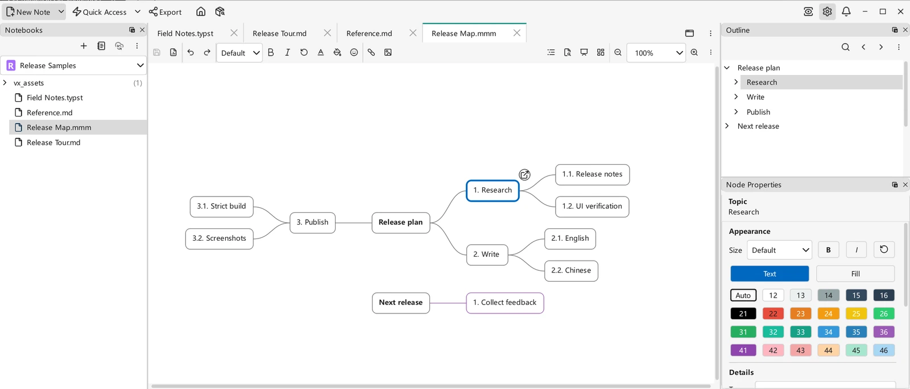

# 思维导图

除 Markdown 之外，VNote 还将**思维导图**作为一等的笔记类型加以支持。思维导图是一种独立的笔记——像 Markdown 笔记一样在笔记本中创建、编辑和存储——你以可视化的方式将其构建为一棵由相连节点组成的树，而非以文本形式书写。

## 思维导图是独立的笔记类型

在 VNote 中，思维导图**并非**对 Markdown 文档的渲染，而是一种独立的文件类型，由原生 **m3 思维导图编辑器**打开。内置的首选扩展名现为 `.mmm`，同时保留 `.emind` 支持以及已有的自定义后缀设置。思维导图与 Markdown 笔记位于同一个笔记本、文件夹树和导航面板中。

由于思维导图是真正的笔记，你所了解的[笔记管理](../managing-notes/notebooks-folders-notes.md)知识都适用于它：它位于笔记本根文件夹内，当你复制或[同步](../managing-notes/notebook-sync.md)笔记本时随之迁移，也可以用文件夹加以组织。

## 创建思维导图

通过**新建笔记**创建思维导图，并选择 **Mind Map（思维导图）**类型而非 Markdown。使用默认后缀设置时，VNote 会创建 `.mmm` 笔记。内置的 `title.mmm` [模板](templates.md)会将笔记标题用作中心主题，同时保留已有的模板选择。不使用模板的空白导图会显示一个可直接编辑的**中心主题（Central topic）**。

## 编辑思维导图

思维导图编辑器是一块可视化的、基于节点的画布：你可以添加子节点和同级节点、连接并重新排列它们，并展开分支以放射状地组织想法。这让思维导图非常适合头脑风暴、规划，以及梳理那些难以用线性文档表达的关系。

{ .screenshot loading=lazy }

Windows 上采用英文界面的 VNote 4.12.0：带编号的分支、独立树，以及工具停靠面板中的**节点属性（Node Properties）**。此图使用单独创建的演示导图，并非示例笔记本中的内容。

原生编辑器提供节点格式、链接、图片、查找、大纲以及撤销/重做。折叠分支只影响当前编辑器视图，不会修改已保存的导图或其他已打开的视图；折叠和展开都会保留节点位置。

### 构建与导航分支

- 添加子节点和同级节点，或在空白画布上创建**独立树**。通过**布局（Layout）**菜单改变排列方式；VNote 会记住新导图的默认布局。
- 复制整条分支，或通过节点的**复制（Copy）**与**粘贴（Paste）**复用内容。粘贴的节点会获得新 ID，同时保留属性和内部链接，并可一步撤销整次操作。
- 右键点击节点，通过**全部展开（Expand All）**或**全部折叠（Collapse All）**递归显示或隐藏后代节点，只读导图也可使用。悬停在分支上时会显示展开/折叠控件。
- 双击主题或节点空白区域可编辑文字，包括空主题；图片和展开/折叠控件仍保留各自的操作。
- 使用 `Ctrl+H`、`Ctrl+J`、`Ctrl+K` 和 `Ctrl+L` 按方向导航节点。节点和空白画布的右键菜单均提供**快捷键帮助（Shortcuts Help）**。在节点属性中，`Alt+M` 打开**图片（Image）**，`Alt+I` 打开**图标（Icons）**。

### 图片、链接、图标与标签

通过工具栏、节点右键菜单、剪贴板或拖放插入图片与超链接。添加链接时会保留已有主题文字，批量插入可作为一次操作撤销。节点右键菜单还提供图标和标签输入，以及用于节点 URL 的**复制链接（Copy Link）**。

右键点击节点图片可在支持缩放的浮层中查看图片、复制图片或来源地址，以及调整尺寸并通过撤销恢复。参见[图片与图床](images-and-image-host.md)。

外部链接警告与 Markdown、Typst 共用持久保存的**不再询问（Never Ask）**偏好。这不会关闭独立的本地文件警告，也不会绕过受保护笔记的授权检查。

### 节点属性与工具停靠面板

默认情况下，节点属性显示在**工具（Tools）**停靠面板中，面板标题和内容随当前视图变化。若希望把属性面板保留在编辑器内部，请关闭**设置 → 编辑器 → 思维导图编辑器 → 分离节点属性面板（Separate node properties panel）**。应用设置后会立即移动面板，无需重新打开导图，也不会丢失修改。分离窗口始终将属性面板内嵌显示，不会改变主窗口的偏好。折叠内嵌面板与通过**视图 → 窗口列表（Windows List）**显示或隐藏工具停靠面板是两种不同操作。

### 缩放与演示

VNote 会在会话状态中记住固定缩放比例或**适应（Fit）**模式。工具栏提供缩小/放大、**适应**以及 **100%**、**125%**、**150%**、**200%** 预设。需要其他比例时，在缩放框中输入正数百分比并按 `Enter`。控件也会跟随键盘缩放命令及 `Ctrl+滚轮` 同步变化。

按 `F9`（或点击**演示模式（Presentation Mode）**）可全屏演示当前导图，按 `Escape` 退出。内嵌节点属性面板会先折叠，工具栏会淡出以让出空间；这是当前视图的演示模式，不是应用级的 `F11` 全屏切换。

### 思维导图设置

在**设置 → 编辑器 → 思维导图编辑器**中可以配置：

- **字体（Font family）**与**字号（Font size）**——节点文字的默认样式；字体留空时使用界面字体，节点单独设置的字号仍优先于默认值。
- **撤销上限（Undo limit）**——保留的文档命令数上限，`0` 表示不限制。降低上限会丢弃超出范围的撤销/重做历史。
- **确认删除子树（Confirm subtree deletion）**——删除节点及其后代前询问确认。
- **自动分支颜色（Automatic branch colors）**——为新建的主分支分配颜色，不会重新着色已有节点。
- **自动章节编号（Automatic section numbering）**——使用共享的**章节编号模式（Section Number Pattern）**为主题标签编号；主根节点和独立根节点不编号。
- **分离节点属性面板（Separate node properties panel）**——默认开启，控制是否使用上文介绍的工具停靠面板。

应用设置后，已打开的导图会直接更新，无需重新加载，包括节点属性面板的位置。思维导图专用快捷键位于 `editor.mindMapEditor.shortcuts`，而 `PresentationMode` 等共享视图快捷键使用 `editor.core.shortcuts`。参见[设置](../customization/settings.md)和[键盘快捷键](../customization/keyboard-shortcuts.md)。

## 打印与导出

在工具栏的三点**菜单（Menu）**中选择**打印（Print）**，可将当前画布布局缩放至一页，包括文字、图片、链接和正在编辑的节点文字。右键点击空白画布并选择**导出（Export）**，可生成 **Markdown**、**HTML** 或 **PDF**。HTML 和 PDF 除了可视导图，还能包含便于阅读的节点内容文章；参见[导出](../productivity/export.md)。

**当前缓冲区（Current buffer）**导出包含编辑器中未保存的修改。**当前笔记（Current note）**和批量导出会读取已保存的文件；若要包含最新修改，请先保存。加密导图即使已解锁，也不能导出或打印。

## 思维导图与 Markdown 大纲

- 当你想要一棵自由、可视、可直接操作的想法之树时，选择**思维导图**。
- 当你想要线性、以文本为先的内容时，选择带标题和嵌套列表的 **Markdown 笔记**；它的结构依然驱动可交互的[大纲](editor-basics.md)并可导出。参见 [Markdown 语法](markdown-syntax.md)。

二者是互补的笔记类型——根据你想如何记录素材来选择即可。
