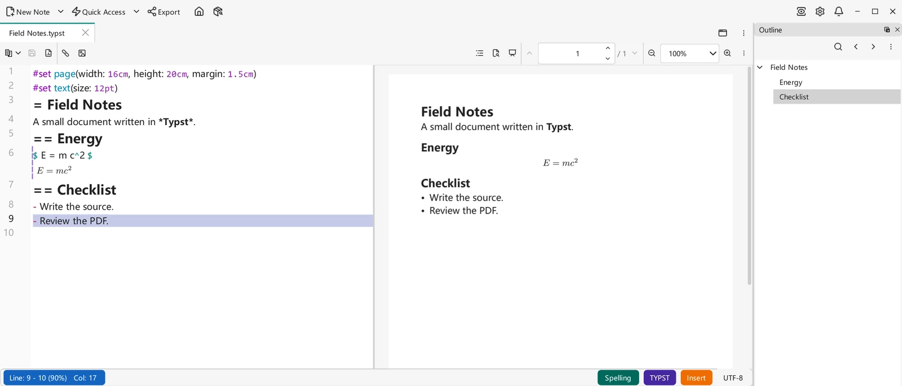

# Typst

VNote 4.11 introduced native **Typst** notes: edit `.typst` source with a bundled compiler, a live PDF preview, in-place previews, and compiler diagnostics. You do not need to install a separate Typst executable to write and preview notes in VNote. This is a separate editor, not a Markdown rendering option.

## Create a Typst note

Choose **New Note → Type → Typst** to create a `.typst` file, or open an existing one. The bundled `title.typst` [template](templates.md) inserts a heading using the filename without its extension; existing template choices are preserved when upgrading.

Try this small document:

```typst
#set page(width: 16cm, height: 20cm, margin: 1.5cm)
#set text(size: 12pt)
= Field Notes
A small document written in *Typst*.
== Energy
$ E = m c^2 $
== Checklist
- Write the source.
- Review the PDF.
```

Typst headings use `=`, `==`, and so on, rather than Markdown's `#`. Typst math also has its own syntax; see the [Typst tutorial](https://typst.app/docs/tutorial/). Native `.typst` notes require unencrypted files; they are not a supported [encrypted note type](../managing-notes/encrypted-notes.md).

{ .screenshot loading=lazy }

VNote 4.12 on Windows, English interface, with the synthetic sample above.

## Edit, preview, and read

- **Edit mode** keeps the source available, with syntax highlighting and compiler diagnostics. Fix errors in the source when compilation fails; an earlier successful preview is not proof that the current source compiled.
- **Menu → Live Preview** shows or hides the compiled PDF pane beside the source.
- **Menu → In-Place Preview** separately controls previews within the source editor. Turning off Live Preview does not turn off In-Place Preview, or vice versa; both start enabled.
- **Read mode** shows only the compiled PDF. Switching back to Edit mode preserves the source editing session rather than reopening the note.

**Find And Replace** searches source text in Edit mode. In Read mode it searches the compiled PDF's text instead, without source replacement. Switch modes deliberately if a word exists in your source but not in the visible document, or vice versa.

## Navigate the PDF

The **Outline** lists compiled headings. Selecting a heading navigates to its location without selecting the heading text. Page controls are available whenever the PDF pane is visible and compilation has produced pages:

- **Previous Page**, **Page**, and **Next Page** move through the compiled document; enter a page number in **Page**.
- Use the zoom controls to choose a scale or fit the page/width. The PDF context menu also offers **Fit width** and **Fit page**, plus **Copy**, **Select page text**, and **Clear selection**.
- **Presentation Mode** (`F9`) presents the PDF; `Escape` exits. This presents compiled pages, not Markdown/reveal.js slides.

Use the toolbar **Mind Map** action or `Ctrl+G, F` for a source-bound [outline mind map](mind-maps.md#outline-mind-maps). Safely mapped, writable Typst headings can be renamed, extended, and reordered from that preview; PDF-only or unmapped headings remain navigation-only.

## Theme and document styles

**Menu → Theme Style in Preview** is enabled by default for each view. It applies theme colors to the default page background and text in previews; explicit document styles take precedence. Turn it off when you want to inspect the document without theme styling. VNote 4.12 also follows the active theme for editor fonts and preview backgrounds and discovers installed system fonts for missing glyphs while respecting configured font precedence.

Theme preview colors do not rewrite your source or become document styles in output. For a particular printed appearance, specify it in the Typst source rather than relying on VNote's theme.

## PDF output and printing { #pdf-output-and-printing }

Since VNote 4.13, the main [Export](../productivity/export.md) dialog supports native Typst **PDF**, **HTML**, and **Typst** source output. Open it from the main file toolbar or press `Ctrl+G, T`, then choose the target:

- **PDF** compiles the document with the bundled Typst compiler, preserving authored page sizes, margins, and layout. It exports typeset pages, not source text; no separate Typst CLI or `wkhtmltopdf` installation is required.
- **HTML** uses Typst's native HTML compiler. Compilation errors and unsupported constructs are reported in the export log; HTML is not a screenshot of the PDF pages.
- **Typst** copies the source and internal relative images. Imported source files and dynamic image references are not bundled; inspect the log and supply those dependencies yourself.

**Current buffer** includes unsaved source changes; **Current note** and batch scopes read disk. Native compilation still requires an existing source file and its project directory, with resources available inside the project. A **Custom** command without **HTML input** uses the original disk file even for Current buffer; see [Custom export](../productivity/export.md#custom).

Native Typst PDF does not use the dialog's web rendering/syntax styles, HTML-based PDF page settings, `wkhtmltopdf`, or PDF **All-in-one**. Set the printed appearance in your Typst source. The shared [export stylesheet](../customization/themes-and-styles.md#applying-export-styles) can style HTML and HTML inputs for custom conversion, but not native Typst PDF. To print typeset pages, export PDF and open it in a PDF application.

## Insert images, links, and files

Use the toolbar's **Insert Image** and **Insert Link**, or paste/drop resources into the source editor. The offered choices depend on the content: **Insert As Image**, **Insert As Relative Image Link**, **Insert As Link**, **Insert As Relative Link**, **Attach And Insert Link**, **Insert As Text**, and **Insert File Content**. File-content insertion requires a local plain-text file; attachment insertion is offered only when the note can store attachments. **Paste as Plain Text** avoids resource insertion choices.

Image context actions in source, in-place previews, and the PDF can view or copy an image, copy its address when available, and resize it when its source can be safely edited. Image overlays support zoom and pan; see [Images & Image Host](images-and-image-host.md).

### Project boundaries

The directory containing the `.typst` file is its **Typst project root**. Keep included source and local image resources inside that directory or its subdirectories. In particular:

- **Insert As Relative Image Link** requires an existing supported image inside the project.
- **Insert As Image** copies the acquired image into the note's image folder. That folder must be inside the note directory; an image-folder configuration pointing outside the project is rejected.
- Image viewing and source-location navigation reject paths that escape the project, including through filesystem links. Copy the resource into the project rather than trying to bypass the boundary.
- Compilation does not automatically download packages. Do not assume a network import or an image outside the project will work merely because it works in another Typst setup.

Local-file hyperlinks are different from resources loaded by the compiler: VNote routes them through its normal file-opening behavior. Markdown, Typst, and mind maps share remembered **Never Ask** choices for local-file and custom-protocol link warnings. Context-menu **Open Link** requests a new tab regardless of the normal new-tab preference; externally handled targets still use their associated application. Warning opt-outs do not bypass protected-note safeguards; see [Settings](../customization/settings.md#markdown-safety-and-math).

## Typst inside Markdown

You do not need to convert a Markdown note to `.typst` to use Typst formulas or figures. [Math & Diagrams](math-and-diagrams.md) explains the optional **Typst** math renderer and independent fenced `typst` blocks, including their Markdown preview/export behavior. Those embedded blocks are not the same as this native document editor or its native export pipeline.
