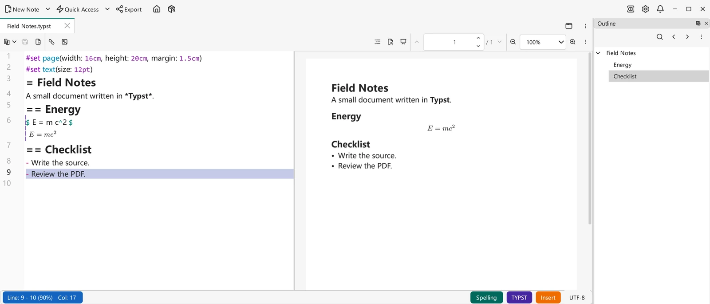

# Typst

VNote 4.11 引入了原生 **Typst** 笔记：使用内置编译器编辑 `.typst` 源码，并提供实时 PDF 预览、原位预览和编译诊断。在 VNote 中写作和预览无需另行安装 Typst 可执行程序。这是独立的编辑器，而非 Markdown 渲染选项。

## 创建 Typst 笔记 { #create-a-typst-note }

选择**新建笔记 → 类型 → Typst** 来创建 `.typst` 文件，或打开已有文件。内置的 `title.typst` [模板](templates.md)使用不含扩展名的文件名插入标题；升级时会保留已有的模板选择。

可以试用这个小文档：

```typst
#set page(width: 16cm, height: 20cm, margin: 1.5cm)
#set text(size: 12pt)
= Field Notes
A small document written in *Typst*.
== Energy
$ E = m c^2 $
== Checklist
- Write the source.
- Review the PDF.
```

Typst 标题使用 `=`、`==` 等，而非 Markdown 的 `#`。Typst 数学公式也有自己的语法，参见 [Typst 教程](https://typst.app/docs/tutorial/)。原生 `.typst` 笔记要求使用未加密文件，不属于支持的[加密笔记类型](../managing-notes/encrypted-notes.md)。

{ .screenshot loading=lazy }

Windows 上的 VNote 4.12，英文界面，使用上方的合成示例。

## 编辑、预览与阅读 { #edit-preview-and-read }

- **编辑模式**保留源码，并提供语法高亮和编译诊断。编译失败时请修正源码；此前成功的预览不能证明当前源码已经编译成功。
- **菜单 → 实时预览（Live Preview）**显示或隐藏源码旁编译后的 PDF 窗格。
- **菜单 → 原位预览（In-Place Preview）**独立控制源码编辑器内的预览。关闭实时预览不会关闭原位预览，反之亦然；两者初始均启用。
- **阅读模式**仅显示编译后的 PDF。切回编辑模式会保留源码编辑会话，而非重新打开笔记。

**查找替换（Find And Replace）**在编辑模式中搜索源码文本，在阅读模式中则搜索编译后的 PDF 文本，不进行源码替换。若某个词只存在于源码或可见文档的一方，请切换到相应模式搜索。

## PDF 导航 { #navigate-the-pdf }

**大纲（Outline）**列出编译后的标题。选择标题会跳转至其位置，不会选中标题文字。当 PDF 窗格可见且已编译出页面时，可以使用翻页控件：

- **上一页（Previous Page）**、**页码（Page）**和**下一页（Next Page）**用于浏览编译后的文档；可在**页码**中输入页数。
- 使用缩放控件选择比例或适应页面/宽度。PDF 右键菜单也提供 **Fit width** 和 **Fit page**，以及 **Copy**、**Select page text** 和 **Clear selection**。
- **演示模式（Presentation Mode）**（`F9`）演示 PDF，按 `Escape` 退出。这里演示的是编译后的页面，而非 Markdown/reveal.js 幻灯片。

## 主题与文档样式 { #theme-and-document-styles }

每个视图默认启用**菜单 → 预览中的主题样式（Theme Style in Preview）**。它把主题颜色应用于预览的默认页面背景与文字，文档中显式指定的样式优先。若想不带主题样式检查文档，请关闭此项。VNote 4.12 也让编辑器字体与预览背景跟随当前主题，并在缺字时发现已安装的系统字体，同时尊重已配置字体的优先级。

主题预览颜色不会改写源码，也不会成为输出中的文档样式。如果需要特定的打印外观，请在 Typst 源码中指定，而非依赖 VNote 主题。

## PDF 输出与打印 { #pdf-output-and-printing }

编译后的 PDF 窗格是预览，并非已保存的 PDF 文件。**VNote 4.12 的原生 Typst 视图没有专门保存/导出编译后 PDF 或打印的操作。**主[导出](../productivity/export.md)对话框可以生成把 Typst **源码当作文本**排版的 PDF；它不是预览中显示的排版结果。

若要创建排版后的 PDF 文件，请保存 `.typst` 源码，并使用另行安装的 [Typst CLI](https://typst.app/open-source/)。在笔记所在目录中使用[官方编译命令](https://github.com/typst/typst#usage)：

```sh
typst compile "Field Notes.typst" "Field Notes.pdf"
```

在 PDF 应用中打开生成的文件即可打印。只有这条输出路径需要外部编译器，VNote 的编辑与预览不需要。请确保该编译器能够访问文档资源与所需字体；编译器版本和字体可能影响输出结果。

## 插入图片、链接与文件 { #insert-images-links-and-files }

使用工具栏的**插入图片（Insert Image）**和**插入链接（Insert Link）**，或向源码编辑器粘贴/拖放资源。根据内容，可选项包括**插入为图片（Insert As Image）**、**插入为相对图片链接（Insert As Relative Image Link）**、**插入为链接（Insert As Link）**、**插入为相对链接（Insert As Relative Link）**、**添加附件并插入链接（Attach And Insert Link）**、**插入为文本（Insert As Text）**和**插入文件内容（Insert File Content）**。文件内容插入要求本地纯文本文件；仅在笔记能够存储附件时提供附件插入。**粘贴为纯文本（Paste as Plain Text）**可以绕过资源插入选项。

源码、原位预览和 PDF 中的图片右键操作可查看或复制图片，在地址可用时复制地址，并在能够安全编辑源码时调整尺寸。图片浮层支持缩放和平移，参见[图片与图床](images-and-image-host.md)。

### 项目边界 { #project-boundaries }

`.typst` 文件所在目录就是其 **Typst 项目根目录**。请把被包含的源码和本地图片资源放在该目录或其子目录中。尤其要注意：

- **插入为相对图片链接**要求项目内已存在受支持的图片。
- **插入为图片**会把获取到的图片复制进笔记的图片文件夹。该文件夹必须位于笔记目录内；指向项目外部的图片文件夹配置会被拒绝。
- 图片查看和源码位置导航会拒绝越出项目的路径，包括通过文件系统链接越界的路径。请把资源复制进项目，而非尝试绕过边界。
- 编译不会自动下载包。不要因为网络导入或项目外图片在其他 Typst 环境可用，就假定这里也能使用。

本地文件超链接不同于编译器加载的资源：VNote 会通过正常的文件打开流程处理它们。Markdown、Typst 和思维导图共用外部链接警告，并会记住**不再询问（Never Ask）**偏好。该偏好不会关闭独立的本地文件警告或受保护笔记的保护机制，参见[设置](../customization/settings.md#markdown-safety-and-math)。

## Markdown 中的 Typst { #typst-inside-markdown }

不必把 Markdown 笔记转换成 `.typst`，也能使用 Typst 公式或图形。[数学与图表](math-and-diagrams.md)介绍了可选的 **Typst** 数学公式渲染器与独立的 `typst` 围栏块，包括其 Markdown 预览/导出行为。它们不同于这里的原生文档编辑器，也不受这里所述的 PDF 输出限制影响。
