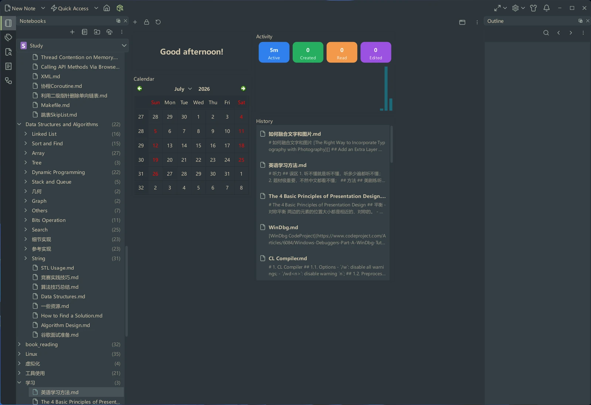
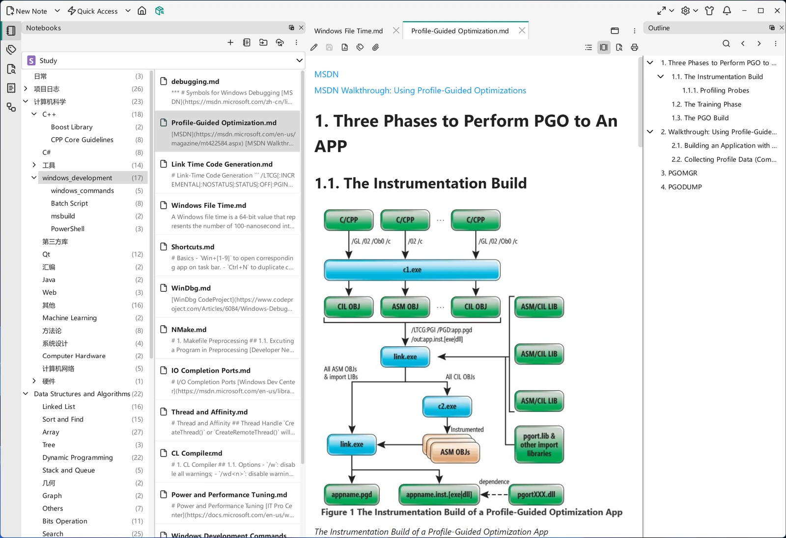

# Dashboard

When VNote opens, you land in its main interface. This page introduces the areas you will use every day so the rest of the documentation feels familiar.

## The main interface

VNote's window is organized into three parts: the dock widgets on the sides, the content area in the middle, and the toolbar and menus along the top.

{ .screenshot }

## Notebooks panel

On the left, the **Notebooks** panel shows your **notebooks**, **folders**, and **notes** in a tree. Use it to switch notebooks, expand folders to any depth, and open notes. Right-click any item for actions such as creating, renaming, importing, and exporting. The panel's title-bar menu offers two layouts: **Combined View**, which shows folders and notes in a single tree, and **Separate View, Double Columns**, which puts the folder tree and the selected folder's notes side by side. See [Notebooks, Folders & Notes](../managing-notes/notebooks-folders-notes.md).

{ .screenshot loading=lazy }

## Content area

The middle area is the **Content Area**, where you read and edit notes. VNote opens notes in **tabs**, so you can keep several notes at once and switch between them. Tabs can be split into multiple side-by-side views, which is handy for comparing notes or writing while referencing another.

## Dock widgets

Around the content area are dock widgets. They can be dragged and dropped freely and docked to the left, top, right, or bottom of the window. The most used are:

- **Notebooks** — the notebook/folder/note tree described above.
- **Outline** — the interactive heading structure of the current note; click a heading to jump to it.
- **Search** — full-text and name search across notebooks; see [Search Panel](../search/search-panel.md).
- **Tags** — browse and filter notes by [tag](../managing-notes/tags.md).
- **History** — recently opened notes; see [Quick Access & History](../managing-notes/quick-access-history.md).
- **Snippets** — insert reusable text; see [Snippets](../editing/snippets.md).

You can show or hide any dock widget from the view menu, and reset the layout if you rearrange things.

## Stickers

The Home tab itself is built from **stickers** — small panels you arrange on a grid. A new configuration starts with **Greeting**, **Calendar**, **Activity** and **History**. Use **Add Sticker** to add more and **Reset Dashboard** to restore the default layout; a sticker's header has a **Remove** button.

The board is **locked** by default, so a stray drag cannot disturb it. Choose **Unlock Dashboard** to rearrange:

- Drag a sticker's centre to move it, or drag an edge or a corner to resize it.
- From the keyboard, press `Tab` to focus a sticker, then move it with the arrow keys and resize it with `Shift` and the arrow keys — one grid cell per press.
- While the board is unlocked, clicks go to the layout rather than to a sticker's content. A drop outside the board is clamped back inside, a drop on an occupied region is rejected, and `Esc` or a right-click cancels the drag.

Lock the board again when you are done. Moving and resizing happen on the board itself: the old header **Move** submenu and **Resize…** dialog are gone, and the header keeps only **Remove**.

## Notifications

Next to the theme control, a notification button shows a badge when something needs your attention. It opens the notification centre, a newest-first list where an entry can offer **Details** or its own actions, and **Clear All** empties the list. Important messages also appear as a toast over the window — or as a tray balloon when the main window is hidden. There is nothing to configure.

## Toolbar and menus

The top of the window provides quick access to common actions — new note, import, export, [Quick Access](../managing-notes/quick-access-history.md), [Tasks](../productivity/tasks.md), [United Entry](../search/united-entry.md), [Settings](../customization/settings.md), and more. The **New → Quick Note** action lets you jot something down instantly without deciding where it belongs yet — see [Quick Note](../productivity/quick-note.md).

## Command-driven navigation

Beyond clicking, VNote is built for the keyboard. Press the [United Entry](../search/united-entry.md) shortcut to search and jump anywhere with short commands, and use [Keyboard Shortcuts](../customization/keyboard-shortcuts.md) — including full [Vi mode](../editing/vi-mode.md) — to work without leaving the home row.

## Next steps

- Start organizing with [Managing Notes](../managing-notes/index.md).
- Learn the editor in [Editor Basics](../editing/editor-basics.md).
