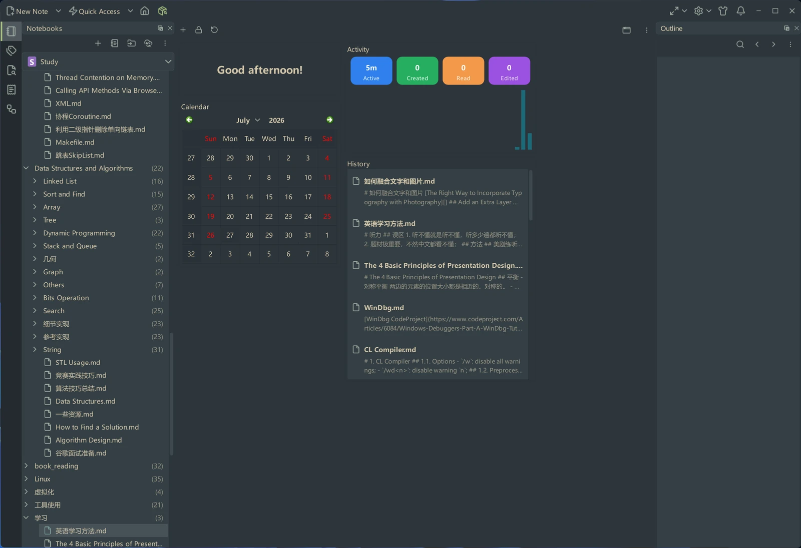

# VNote

**A pleasant note-taking platform.**

VNote is a free, open-source note-taking app that makes writing, organizing, and exploring your notes simple and enjoyable.

[Get Started](getting-started/index.md){ .md-button .md-button--primary }
[Download VNote](https://github.com/vnotex/vnote/releases/latest){ .md-button }
[Download VNote from Gitee](https://gitee.com/vnotex/vnote/releases){ .md-button }

{ .screenshot }

!!! info "Documentation for VNote 4.12.0"
    Updated for [VNote 4.10.0](https://github.com/vnotex/vnote/releases/tag/v4.10.0), [4.11.0](https://github.com/vnotex/vnote/releases/tag/v4.11.0), and [4.12.0](https://github.com/vnotex/vnote/releases/tag/v4.12.0): native [Typst notes](editing/typst.md), [editable link previews](editing/editor-basics.md#link-previews), richer [mind maps and exports](editing/mind-maps.md), and safer [custom tasks](productivity/tasks.md). Before upgrading, check the [Windows requirements](getting-started/installation.md#requirements) and [encrypted-note format changes](managing-notes/encrypted-notes.md).

## What is VNote?

Whether you're keeping a personal journal, building a knowledge base, taking study notes, writing documentation, or organizing ideas, VNote gives you a comfortable place to keep your work together.

VNote is especially well suited to **Markdown**, combining a powerful editor with practical note-management features. But it goes beyond Markdown: you can also work with **mind maps**, **Typst documents**, **plain text files**, and more, all within the same app.

## Why VNote

-   :material-pencil-outline:{ .lg .middle } __Write comfortably__

    ---

    A comfortable editing experience helps you concentrate on your content, whether you're jotting down a thought or writing something longer.

-   :material-folder-multiple-outline:{ .lg .middle } __Keep your notes organized__

    ---

    Organize notes into notebooks and folders, and quickly find what you need as your collection grows.

-   :material-language-markdown:{ .lg .middle } __Use Markdown without the friction__

    ---

    Write and preview Markdown naturally, whether you're new to Markdown or already use it every day.

-   :material-sitemap:{ .lg .middle } __Turn ideas into mind maps__

    ---

    Create and edit mind maps to explore connections and give your ideas a clear visual structure.

-   :material-file-document-outline:{ .lg .middle } __Work with more than notes__

    ---

    Edit plain-text files, write Typst documents with live PDF preview, and read PDFs without switching between apps.

-   :material-lock-outline:{ .lg .middle } __Keep your files in your hands__

    ---

    Keep your work in local files, with notebooks you can back up, move, and manage using familiar tools.

## Your notes, your way

VNote gives you a flexible workspace built around local files, with support for open formats such as Markdown, plain text, and Typst. Your notes stay under your control.

Start with a few Markdown notes, build a personal knowledge base, sketch an idea as a mind map, or simply use VNote as a pleasant place to write.

**VNote is a home for your notes, ideas, and knowledge.**

## Explore the documentation

-   :material-rocket-launch-outline:{ .lg .middle } __Getting Started__

    ---

    Install VNote, take your first note, and get to know the dashboard.

    [:octicons-arrow-right-24: Getting Started](getting-started/index.md)

-   :material-notebook-outline:{ .lg .middle } __Managing Notes__

    ---

    Organize notebooks, folders, and notes; use tags, sync, quick access, and history.

    [:octicons-arrow-right-24: Managing Notes](managing-notes/index.md)

-   :material-pencil-outline:{ .lg .middle } __Editing__

    ---

    Write and format across VNote's editors — Markdown, Typst, math, diagrams, snippets, templates, mind maps, and Vi mode.

    [:octicons-arrow-right-24: Editing](editing/index.md)

-   :material-magnify:{ .lg .middle } __Search__

    ---

    Find notes fast with the search panel and the united entry.

    [:octicons-arrow-right-24: Search](search/index.md)

-   :material-lightning-bolt-outline:{ .lg .middle } __Productivity__

    ---

    Automate work with tasks and export your notes to other formats.

    [:octicons-arrow-right-24: Productivity](productivity/index.md)

-   :material-cog-outline:{ .lg .middle } __Customization__

    ---

    Configure settings, apply themes and styles, and tailor keyboard shortcuts.

    [:octicons-arrow-right-24: Customization](customization/index.md)

## Open source and free

- Licensed under [GNU LGPLv3](https://opensource.org/licenses/LGPL-3.0).
- Powered by Qt and C++.
- Available on Linux, Windows, and macOS.

## Get involved

- Star and follow VNote on [GitHub](https://github.com/vnotex/vnote).
- Report issues via [GitHub Issues](https://github.com/vnotex/vnote/issues).

!!! tip "Need help?"
    Check the [Help](help/index.md) section for frequently asked questions and data migration guidance.
