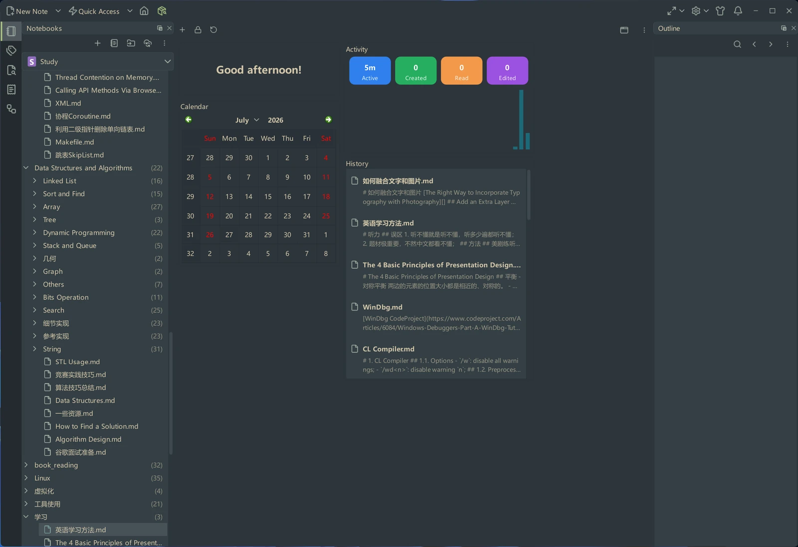

# VNote

**一个舒适的笔记平台。**

VNote 是一款免费、开源的笔记应用，致力于让记录、整理和探索笔记变得简单而愉快。

[开始使用](getting-started/index.md){ .md-button .md-button--primary }
[从 Gitee 下载 VNote](https://gitee.com/vnotex/vnote/releases){ .md-button }
[下载 VNote](https://github.com/vnotex/vnote/releases/latest){ .md-button }

{ .screenshot }

!!! info "适用于 VNote 4.12.0 的文档"
    文档涵盖 [VNote 4.10.0](https://github.com/vnotex/vnote/releases/tag/v4.10.0)、[4.11.0](https://github.com/vnotex/vnote/releases/tag/v4.11.0) 和 [4.12.0](https://github.com/vnotex/vnote/releases/tag/v4.12.0)：原生 [Typst 笔记](editing/typst.md)、[可编辑的链接预览](editing/editor-basics.md#link-previews)、更丰富的[思维导图与导出](editing/mind-maps.md)，以及更安全的[自定义任务](productivity/tasks.md)。升级前，请查看 [Windows 系统要求](getting-started/installation.md)和[加密笔记格式变化](managing-notes/encrypted-notes.md)。

## 什么是 VNote？

无论是记录生活、构建个人知识库、整理学习笔记、撰写文档，还是梳理灵感与想法，VNote 都能为你提供一个舒适、统一的工作空间。

VNote 尤其擅长 **Markdown**，将强大的编辑体验与实用的笔记管理功能结合在一起。不过，VNote 并不只是 Markdown 编辑器：你还可以在同一个应用中使用**思维导图**、**Typst 文档**、**纯文本文件**等多种内容形式。

## 为什么选择 VNote

-   :material-pencil-outline:{ .lg .middle } __舒适地写作__

    ---

    无论是随手记下一个想法，还是撰写一篇长文，舒适的编辑体验都能让你把注意力放在内容本身。

-   :material-folder-multiple-outline:{ .lg .middle } __井井有条地管理笔记__

    ---

    通过笔记本和文件夹整理笔记。即使笔记越来越多，也能快速找到需要的内容。

-   :material-language-markdown:{ .lg .middle } __轻松使用 Markdown__

    ---

    自然地编写和预览 Markdown。无论你刚刚接触 Markdown，还是已经每天都在使用它，都能轻松上手。

-   :material-sitemap:{ .lg .middle } __用思维导图整理想法__

    ---

    直接创建和编辑思维导图，梳理想法之间的联系，让思路与知识结构一目了然。

-   :material-file-document-outline:{ .lg .middle } __不止于笔记__

    ---

    编辑纯文本文件，通过实时 PDF 预览撰写 Typst 文档，还可以直接阅读 PDF，无需频繁在多个应用之间切换。

-   :material-lock-outline:{ .lg .middle } __文件始终掌握在自己手中__

    ---

    内容保存在本地文件中，你可以使用熟悉的工具备份、移动和管理笔记本。

## 你的笔记，由你掌控

VNote 围绕本地文件构建，支持 Markdown、纯文本和 Typst 等开放格式，为你提供灵活的工作空间，让笔记始终由你掌控。

你可以从几篇 Markdown 笔记开始，逐渐建立自己的知识库；也可以用思维导图梳理想法，或者仅仅把 VNote 当作一个舒适、愉快的写作空间。

**VNote，为你的笔记、想法与知识提供一个长久的家。**

## 浏览文档

-   :material-rocket-launch-outline:{ .lg .middle } __快速开始__

    ---

    安装 VNote，记录第一篇笔记，并了解仪表盘。

    [:octicons-arrow-right-24: 快速开始](getting-started/index.md)

-   :material-notebook-outline:{ .lg .middle } __管理笔记__

    ---

    组织笔记本、文件夹和笔记；使用标签、同步、快速访问和历史记录。

    [:octicons-arrow-right-24: 管理笔记](managing-notes/index.md)

-   :material-pencil-outline:{ .lg .middle } __编辑__

    ---

    在 VNote 的各类编辑器中书写与排版——Markdown、Typst、数学公式、图表、片段、模板、思维导图和 Vi 模式。

    [:octicons-arrow-right-24: 编辑](editing/index.md)

-   :material-magnify:{ .lg .middle } __搜索__

    ---

    通过搜索面板和统一入口快速找到笔记。

    [:octicons-arrow-right-24: 搜索](search/index.md)

-   :material-lightning-bolt-outline:{ .lg .middle } __效率__

    ---

    使用任务自动化工作，并将笔记导出为其他格式。

    [:octicons-arrow-right-24: 效率](productivity/index.md)

-   :material-cog-outline:{ .lg .middle } __自定义__

    ---

    配置设置，应用主题与样式，并自定义键盘快捷键。

    [:octicons-arrow-right-24: 自定义](customization/index.md)

## 开源和自由

- 遵从 [GNU LGPLv3](https://opensource.org/licenses/LGPL-3.0) 开源协议。
- 由 Qt 和 C++ 提供强劲性能。
- 支持 Linux、Windows 和 macOS。

## 参与其中

- 在 [GitHub](https://github.com/vnotex/vnote) 上关注并 Star VNote。
- 通过 [GitHub Issues](https://github.com/vnotex/vnote/issues) 反馈问题。

!!! tip "需要帮助？"
    请查阅[帮助](help/index.md)章节，获取常见问题解答和数据迁移指南。
