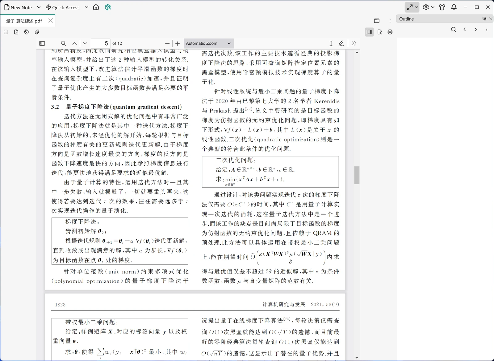

# PDF Viewer

VNote opens `.pdf` files in a built-in viewer — a bundled pdf.js 3.11.174 — so a PDF that lives in a notebook — a paper, a manual, a scanned handout — can be read next to your notes without leaving the application. PDFs are view-only: VNote never modifies them, and you cannot create a PDF note (see [File Types](file-types.md)).

{ .screenshot loading=lazy }

## Reading a PDF

Open a PDF the way you open any other note — from the notebook explorer, from [Quick Access & History](quick-access-history.md), or by dragging the file into the content area. The viewer provides the usual controls: page navigation, zoom, rotation, and a text search over the document.

Because a PDF opens in an ordinary view window, everything you know about tabs applies: you can split the content area and keep the PDF beside the note you are writing, or detach it into its own window. See [Editor Basics](../editing/editor-basics.md).

The viewer's own navigation pane (thumbnails and bookmarks) is hidden when a document opens, so the page itself gets the full width. Toggle it from the viewer's toolbar when you want it.

## Outline and bookmarks

If the PDF carries an embedded outline (its bookmarks), VNote reads it and offers two ways to navigate:

- The **Outline** dock shows the PDF's outline just like the heading structure of a Markdown note. Click an entry to jump to that page.
- Each view window has an **Outline** popup in its toolbar, which is handy for a detached or split window that cannot see the dock.

Very large outlines are truncated at 5000 entries; the rest of the document is still fully readable.

## Limitations

Annotating, filling forms, and editing are out of scope — use a dedicated PDF application for those. To turn your own notes into a PDF, see [Export](../productivity/export.md).

!!! warning "This behaves differently per operating system"
    The built-in viewer requires the Qt 6 builds (Windows, Linux and macOS). On the `win64-windows7` package, which is built against Qt 5.15, opening a PDF shows an **empty viewer**: its Chromium 83 engine cannot parse the bundled pdf.js. This is a known limitation of that package. Open PDFs in an external viewer there — or associate `.pdf` with your system's PDF application under **Settings → File Associations → External Programs**.
