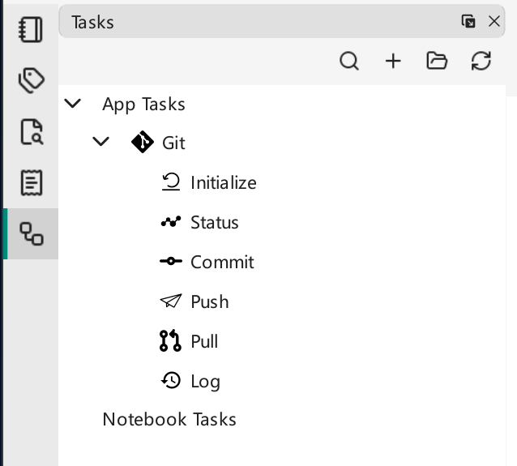

# Tasks

VNote includes a simple **task** system, modeled on [VSCode Tasks](https://code.visualstudio.com/docs/editor/tasks), that lets you run third-party programs and scripts from within VNote. Use it to compile the current note, run a local server, open a file in another editor, drive git, or anything else you can script.

!!! warning "Keep shell code separate from data"
    In VNote 4.12, a shell task's `command`, `options.shell.executable`, and `options.shell.args` must be static task-authored text, without VNote variables. Put filenames, selected text, and prompt results in separate `args` entries instead of interpolating them into shell source. Values are no longer recursively expanded. Prefer `type: process` when you only need to run a program with arguments, and only run task definitions you trust.

{ .screenshot loading=lazy }

## How tasks are loaded

VNote loads tasks from the application's data folder and the current bundled notebook:

- Application data `tasks/` — your personal tasks and the deployed built-in tasks. **Open Task Folder** in the Tasks panel opens this location.
- `<notebook root>/vx_notebook/tasks/` — tasks scoped to a bundled notebook. Raw notebooks have no notebook task folder.

Each task is defined by a `*.json` entry file; subfolders are scanned recursively. See [Settings](../customization/settings.md) for the application data location. Keep custom tasks in their own files rather than editing a shipped task that an upgrade can replace.

## A simple task

In the Tasks panel, click **Open Task Folder**. Create a folder named `hello`, and inside it a file `hello.json`:

```json
{
    "type": "shell",
    "command": "echo",
    "args": ["Hello Tasks"]
}
```

Click **Reload** in the Tasks panel and a `hello` task appears. Double-click it or choose **Run** from its context menu; output appears in **Console**. These shell examples use the default PowerShell on Windows or Bash on Linux/macOS. You can also create an editable starter file with **New Task**, or run tasks from [United Entry](../search/united-entry.md) with the `task` command.

### Customize the menu item

```json
{
    "label": "Hello",
    "icon": "tasks-solid.svg",
    "shortcut": "Alt+H, T",
    "command": "echo",
    "args": ["Hello tasks!"]
}
```

Save the icon file (`tasks-solid.svg`) next to the JSON entry file.

### Sub-tasks

Tasks can nest to any depth. Sub-tasks inherit the version, type, command, arguments, and execution options, but not the label, inputs, or child tasks. Declare a prompt's `inputs` on the sub-task that uses it.

```json
{
    "label": "Hello Tasks",
    "icon": "tasks-solid.svg",
    "command": "echo",
    "args": ["Hello tasks!"],
    "tasks": [
        { "label": "Hello Cat", "icon": "cat-solid.svg", "args": ["Hello cat!"] },
        { "label": "Hello Dove", "icon": "dove-solid.svg", "args": ["Hello dove!"] }
    ]
}
```

### Command types

The `type` property controls how a command runs:

- `shell` (default) — run static command text through a shell. Tasks with nonempty `args` require **Bash** or **PowerShell** (`powershell`/`pwsh`); `cmd.exe`, `sh`, and other shells are not supported for this form. VNote passes each value as a literal argument rather than inserting it into the shell script.
- `process` — run one executable with a separate argument list, without a shell. Shell operators such as pipes and `;` do not work here. Prefer this form for external programs.

For example, open the current saved file in Windows Notepad:

```json
{
    "type": "process",
    "label": "Open in Notepad",
    "command": "notepad.exe",
    "args": ["${buffer}"]
}
```

Each `args` entry is one argument: write `"${buffer}"`, not a value with additional shell quotes around it. For an executable outside `PATH`, use its actual absolute path as `command`; JSON requires doubled backslashes, as in `"C:\\Program Files\\My Editor\\editor.exe"`. Do not add shell quotes around a process executable path. VNote's Console is an output viewer, not an interactive terminal; programs that need terminal input should be launched in a terminal application.

### Localization and platform-specific options

Provide a locale-string object to localize a field, and use `windows`/`linux`/`osx` keys for per-platform options.

```json
{
    "type": "shell",
    "label": { "en_US": "Hello", "zh_CN": "你好" },
    "command": "echo",
    "args": ["Hello Tasks"],
    "windows": { "command": "Write-Output" },
    "linux": { "command": "echo" },
    "osx": { "command": "echo" }
}
```

## Task options

A task supports many options (`[m]` marks mandatory, `[l]` marks localizable):

- `version` — the version of the task file
- `label[l]` — the task name
- `type` — `shell` (default) or `process`
- `command[l]` — static shell command text, or a process executable
- `args[l]` — an array of literal arguments; VNote variables are expanded within each entry
- `options`
    - `cwd` — working directory; supports VNote variables and falls back to notebook root, then buffer folder, then task file folder when omitted
    - `env` — environment-variable names and literal string values, added to the inherited process environment; these values do **not** expand VNote variables in v4.12
    - `shell` — static `executable` and `args` for shell tasks; defaults are `PowerShell.exe` with `-Command` on Windows and `/bin/bash` with `-c` on Linux/macOS. Use `-Command` for `pwsh` too; keep startup options static.
- `tasks` — sub-tasks
- `inputs` — input variables
    - `id[m]`, `type` (`promptString` by default), `description[l]`, `default[l]`, `password`; the parser also accepts `pickString` and `options[l]`, but see the current limitation below
- `windows` / `linux` / `osx` — per-platform options

## Variables

Use `${variableName}` in `args` or `options.cwd`. A process task also supports variables in `command`, but use a fixed, trusted executable in normal tasks; never use user-supplied text to choose code to run. Shell commands and shell startup options cannot contain VNote variables. `options.env` values are literal: use `${env:NAME}` in an argument or working directory to read the inherited environment, not in `options.env` expecting another expansion.

Only the authored template is scanned once. If selected text, prompt input, an environment value, or shell output contains `${buffer}` or `${shell:...}`, that returned text stays data; VNote does not evaluate it again. Avoid a self-reference such as `${cwd}` in `options.cwd`; use a concrete path or `${bufferDir}`, `${notebookFolder}`, or `${taskDir}` instead.

**Notebook:** `notebookFolder`, `notebookFolderName`, `notebookName`, `notebookDescription`.

**Buffer:** `buffer`, `bufferNotebookFolder`, `bufferRelativePath`, `bufferName`, `bufferBaseName`, `bufferDir`, `bufferExt`, `selectedText`.

**Task/paths:** `cwd`, `taskFile`, `taskDir`, `exeFile`, `pathSeparator`, `notebookTaskFolder`, `taskFolder`, `themeFolder`.

**Special:**

- `${magic:snippet_name}` — call a VNote [snippet](../editing/snippets.md).
- `${env:env_name}` — read an environment variable.
- `${config:[main|session].json_path}` — read a VNote configuration value, e.g. `${config:main.core.shortcuts.FullScreen}`.
- `${shell:command}` — substitute a trusted, static shell command's standard output; restrictions below apply.

### Input variables

Prompt the user with `${input:input_id}`:

```json
{
    "command": "echo",
    "args": ["${input:what}"],
    "inputs": [
        { "id": "what", "type": "promptString", "description": "Type something." }
    ]
}
```

In v4.12, `promptString` is the usable input type. Although `pickString` is parsed, invoking it cancels the task instead of opening a selection dialog. Put `inputs` on the task that references them; they are not inherited by sub-tasks.

### Shell variables

`${shell:command}` executes shell code, so write only trusted, static commands directly in the JSON template; do not construct them from filenames, selected text, input values, or other VNote variables. Nested VNote-variable expansion is not supported. The command uses the platform's default shell and the task's working directory, not a custom `options.shell`, and must finish promptly (the output lookup waits up to one second for startup and completion).

- `${shell:git rev-parse --abbrev-ref HEAD}` — the current Git branch name, when the task runs inside a Git repository.
- `${shell:whoami}` — your user name.

Use the result in `args`. Standard output, including any trailing newline, is returned as data and is not recursively evaluated.

## Examples

### Compute a file hash on Windows

This PowerShell task computes the SHA-256 hash of the current file without modifying it. Save it as `hash/hash.json` under **Open Task Folder**, click **Reload**, then open a saved, ordinary note and run **SHA-256 of Current File**. **Console** shows the algorithm, hash, and path. It reads the file on disk, so save edits first; this is not an export of an unlocked encrypted body.

```json
{
    "label": "SHA-256 of Current File",
    "type": "shell",
    "command": "Get-FileHash -Algorithm SHA256 -LiteralPath",
    "args": ["${buffer}"],
    "options": {
        "cwd": "${bufferDir}",
        "shell": {
            "executable": "PowerShell.exe",
            "args": ["-NoProfile", "-Command"]
        }
    }
}
```

The command and PowerShell startup options are static. Only the separate filename argument is dynamic, so spaces and shell punctuation in a filename do not become commands. `-LiteralPath` also avoids treating filename characters as PowerShell wildcards.

### Inspect Git changes for the current file

With Git installed and the saved current note inside a Git working tree, this process task shows a summary of its unstaged changes:

```json
{
    "label": "Git Changes for Current File",
    "type": "process",
    "command": "git",
    "args": ["diff", "--stat", "--", "${buffer}"],
    "options": {
        "cwd": "${bufferDir}",
        "env": { "LC_ALL": "C" }
    }
}
```

Here the working directory expands a VNote variable, while `LC_ALL` is a literal environment value. The `--` separates Git options from the file path. This task does not commit or modify files.

The built-in [Git task](https://github.com/vnotex/vnote/blob/3d4c806c29de7a01416da5352d22bfe21bc6a128/src/data/extra/tasks/git/git.json) is another reference: its commit command is static, and the prompted commit message is passed through `args`, with a separate static PowerShell command for Windows.
