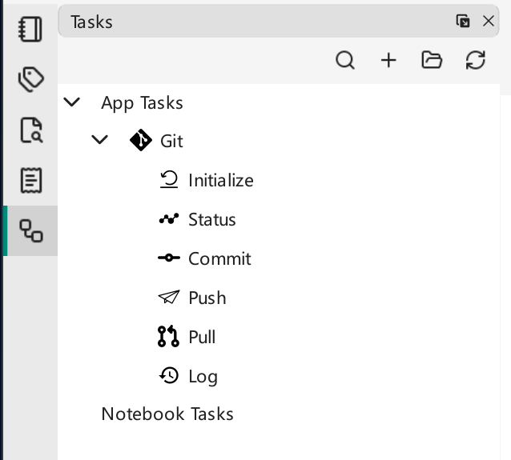

# 任务

VNote 内置了一套简单的**任务**系统，其设计参照 [VSCode Tasks](https://code.visualstudio.com/docs/editor/tasks)，让你能在 VNote 内运行第三方程序和脚本。用它来编译当前笔记、运行本地服务器、用其他编辑器打开文件、驱动 git，或任何你能编写脚本完成的事。

!!! warning "将 shell 代码与数据分开"
    VNote 4.12 中，shell 任务的 `command`、`options.shell.executable` 和 `options.shell.args` 必须是任务作者写定的静态文本，不能包含 VNote 变量。文件名、选中文本和提示输入的结果应放在独立的 `args` 项中，而不是插入 shell 代码。变量值不再递归展开。只需运行程序并传参时，优先使用 `type: process`，且只运行可信的任务定义。

{ .screenshot loading=lazy }

## 任务如何加载

VNote 从应用数据文件夹和当前捆绑笔记本加载任务：

- 应用数据目录下的 `tasks/`——个人任务及已部署的内置任务。任务面板中的**打开任务文件夹（Open Task Folder）**会打开此位置。
- `<笔记本根目录>/vx_notebook/tasks/`——限定于某个捆绑笔记本的任务。原始笔记本没有笔记本任务文件夹。

每个任务由一个 `*.json` 入口文件定义，子文件夹会被递归扫描。应用数据位置参见[设置](../customization/settings.md)。自定义任务应使用自己的文件，不要直接修改升级时可能被替换的内置任务。

## 一个简单的任务

在任务面板中点击**打开任务文件夹（Open Task Folder）**。创建一个名为 `hello` 的文件夹，并在其中创建文件 `hello.json`：

```json
{
    "type": "shell",
    "command": "echo",
    "args": ["Hello Tasks"]
}
```

点击任务面板中的**重新加载（Reload）**，一个 `hello` 任务便会出现。双击它，或从右键菜单选择**运行（Run）**；输出显示在**控制台（Console）**中。这些 shell 示例使用 Windows 默认的 PowerShell，或 Linux/macOS 默认的 Bash。你也可以用**新建任务（New Task）**创建可编辑的初始文件，或在[统一入口](../search/united-entry.md)中用 `task` 命令运行任务。

### 自定义菜单项

```json
{
    "label": "Hello",
    "icon": "tasks-solid.svg",
    "shortcut": "Alt+H, T",
    "command": "echo",
    "args": ["Hello tasks!"]
}
```

把图标文件（`tasks-solid.svg`）与 JSON 入口文件放在一起。

### 子任务

任务可以任意层级嵌套。子任务继承版本、类型、命令、参数和执行选项，但不继承标签、输入定义或子任务列表。提示输入所需的 `inputs` 应定义在使用它的子任务中。

```json
{
    "label": "Hello Tasks",
    "icon": "tasks-solid.svg",
    "command": "echo",
    "args": ["Hello tasks!"],
    "tasks": [
        { "label": "Hello Cat", "icon": "cat-solid.svg", "args": ["Hello cat!"] },
        { "label": "Hello Dove", "icon": "dove-solid.svg", "args": ["Hello dove!"] }
    ]
}
```

### 命令类型

`type` 属性控制命令如何运行：

- `shell`（默认）——通过 shell 执行静态命令文本。`args` 非空时必须使用 **Bash** 或 **PowerShell**（`powershell`/`pwsh`）；这种形式不支持 `cmd.exe`、`sh` 等其他 shell。VNote 将每个值作为字面参数传递，而不是插入 shell 脚本。
- `process`——直接运行一个可执行程序并传入独立的参数列表，不经过 shell。管道和 `;` 等 shell 运算符在这里无效。运行外部程序时应优先使用此形式。

例如，用 Windows 记事本打开当前已保存的文件：

```json
{
    "type": "process",
    "label": "Open in Notepad",
    "command": "notepad.exe",
    "args": ["${buffer}"]
}
```

每个 `args` 项就是一个参数：写成 `"${buffer}"` 即可，不要额外添加 shell 引号。可执行程序不在 `PATH` 中时，将其实际绝对路径用作 `command`；JSON 中的反斜杠需要双写，例如 `"C:\\Program Files\\My Editor\\editor.exe"`。不要为 process 类型的可执行文件路径添加 shell 引号。VNote 控制台用于查看输出，并非交互式终端；需要终端输入的程序应在终端应用中启动。

### 本地化与平台专属选项

提供一个 locale-string 对象来本地化某个字段，并用 `windows`/`linux`/`osx` 键设置各平台的选项。

```json
{
    "type": "shell",
    "label": { "en_US": "Hello", "zh_CN": "你好" },
    "command": "echo",
    "args": ["Hello Tasks"],
    "windows": { "command": "Write-Output" },
    "linux": { "command": "echo" },
    "osx": { "command": "echo" }
}
```

## 任务选项

任务支持许多选项（`[m]` 表示必填，`[l]` 表示可本地化）：

- `version`——任务文件的版本
- `label[l]`——任务名称
- `type`——`shell`（默认）或 `process`
- `command[l]`——静态 shell 命令文本，或 process 类型的可执行程序
- `args[l]`——字面参数数组；每个项目内可展开 VNote 变量
- `options`
    - `cwd`——工作目录，支持 VNote 变量；省略时依次回退到笔记本根目录、缓冲区文件夹、任务文件所在文件夹
    - `env`——环境变量名及字面字符串值，添加到继承的进程环境中；v4.12 **不会**展开这些值中的 VNote 变量
    - `shell`——shell 任务的静态 `executable` 和 `args`；Windows 默认为 `PowerShell.exe` 与 `-Command`，Linux/macOS 默认为 `/bin/bash` 与 `-c`。`pwsh` 也使用 `-Command`；启动选项必须保持静态。
- `tasks`——子任务
- `inputs`——输入变量
    - `id[m]`、`type`（默认为 `promptString`）、`description[l]`、`default[l]`、`password`；解析器也接受 `pickString` 和 `options[l]`，但存在下文所述限制
- `windows` / `linux` / `osx`——各平台选项

## 变量

在 `args` 或 `options.cwd` 中使用 `${variableName}`。process 任务也支持在 `command` 中使用变量，但普通任务应使用固定、可信的可执行程序；切勿让用户提供的文本决定运行什么代码。shell 命令与 shell 启动选项不能包含 VNote 变量。`options.env` 的值为字面量：应在参数或工作目录中用 `${env:NAME}` 读取继承的环境变量，而不是将其放进 `options.env` 并期待再次展开。

只扫描任务作者写定的模板一次。如果选中文本、提示输入、环境变量值或 shell 输出包含 `${buffer}` 或 `${shell:...}`，返回的文本仍是数据，VNote 不会再次求值。不要在 `options.cwd` 中用 `${cwd}` 自我引用；请使用具体路径，或 `${bufferDir}`、`${notebookFolder}`、`${taskDir}`。

**笔记本：**`notebookFolder`、`notebookFolderName`、`notebookName`、`notebookDescription`。

**缓冲区：**`buffer`、`bufferNotebookFolder`、`bufferRelativePath`、`bufferName`、`bufferBaseName`、`bufferDir`、`bufferExt`、`selectedText`。

**任务/路径：**`cwd`、`taskFile`、`taskDir`、`exeFile`、`pathSeparator`、`notebookTaskFolder`、`taskFolder`、`themeFolder`。

**特殊：**

- `${magic:snippet_name}`——调用 VNote [片段](../editing/snippets.md)。
- `${env:env_name}`——读取环境变量。
- `${config:[main|session].json_path}`——读取 VNote 配置值，例如 `${config:main.core.shortcuts.FullScreen}`。
- `${shell:command}`——替换为可信静态 shell 命令的标准输出，受下文限制。

### 输入变量

用 `${input:input_id}` 提示用户输入：

```json
{
    "command": "echo",
    "args": ["${input:what}"],
    "inputs": [
        { "id": "what", "type": "promptString", "description": "输入一些内容。" }
    ]
}
```

v4.12 中可用的输入类型为 `promptString`。虽然能解析 `pickString`，调用它时会取消任务，而不会打开选择对话框。`inputs` 应定义在引用它的任务中；子任务不会继承此定义。

### Shell 变量

`${shell:command}` 会执行 shell 代码，因此只能在 JSON 模板中直接写入可信的静态命令；不要通过文件名、选中文本、输入值或其他 VNote 变量拼接命令。不支持嵌套展开 VNote 变量。命令使用平台默认 shell 和任务工作目录，而非自定义的 `options.shell`，且必须迅速完成（获取输出时，对启动和完成的等待各最多一秒）。

- `${shell:git rev-parse --abbrev-ref HEAD}`——任务在 Git 仓库中运行时，返回当前 Git 分支名。
- `${shell:whoami}`——你的用户名。

在 `args` 中使用结果。标准输出作为数据返回，包括可能存在的末尾换行，不会递归求值。

## 示例

### 在 Windows 上计算文件哈希

这个 PowerShell 任务计算当前文件的 SHA-256 哈希，不会修改文件。将它保存为**打开任务文件夹（Open Task Folder）**下的 `hash/hash.json`，点击**重新加载（Reload）**，然后打开一篇已保存的普通笔记，运行 **SHA-256 of Current File**。**控制台（Console）**会显示算法、哈希和路径。它读取磁盘文件，因此应先保存编辑；这不是导出已解锁的加密正文。

```json
{
    "label": "SHA-256 of Current File",
    "type": "shell",
    "command": "Get-FileHash -Algorithm SHA256 -LiteralPath",
    "args": ["${buffer}"],
    "options": {
        "cwd": "${bufferDir}",
        "shell": {
            "executable": "PowerShell.exe",
            "args": ["-NoProfile", "-Command"]
        }
    }
}
```

命令与 PowerShell 启动选项都是静态的。只有独立的文件名参数是动态的，因此文件名中的空格和 shell 标点不会变成命令。`-LiteralPath` 还避免将文件名中的字符解释为 PowerShell 通配符。

### 查看当前文件的 Git 改动

安装 Git 且当前已保存的笔记位于 Git 工作树中时，这个 process 任务会显示该文件尚未暂存的改动摘要：

```json
{
    "label": "Git Changes for Current File",
    "type": "process",
    "command": "git",
    "args": ["diff", "--stat", "--", "${buffer}"],
    "options": {
        "cwd": "${bufferDir}",
        "env": { "LC_ALL": "C" }
    }
}
```

这里的工作目录会展开 VNote 变量，而 `LC_ALL` 是字面环境变量值。`--` 将 Git 选项与文件路径分开。此任务不会提交或修改文件。

内置的 [Git 任务](https://github.com/vnotex/vnote/blob/3d4c806c29de7a01416da5352d22bfe21bc6a128/src/data/extra/tasks/git/git.json)也是一个参考：提交命令是静态的，提示输入的提交信息通过 `args` 传递，Windows 则使用单独的静态 PowerShell 命令。
