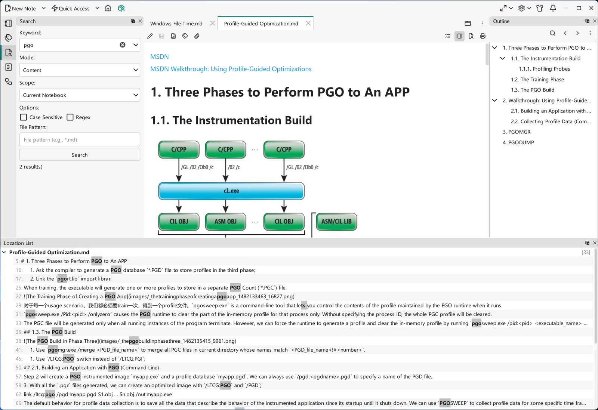

# Search Panel

The **Search** dock widget is VNote's full search interface. Where [United Entry](united-entry.md) is a fast, command-driven jump box, the search panel gives you the full set of options for finding notes by name or by content across your notebooks.

## Opening search

Open the **Search** dock widget from the navigation bar or its shortcut. Type your query, choose the scope and target, and run the search; matches are listed in the **Location List** below the content area, and selecting one opens the note.

{ .screenshot loading=lazy }

## What you can search

Search has two dimensions: **what** you match on and **where** you look.

Match on:

- **Content** — the text inside notes (full-text search).
- **Name** — the names of folders and files.
- **Tag** — notes carrying a given [tag](../managing-notes/tags.md).

Look in:

- **All notebooks** — everything you have open in VNote.
- **Current notebook** — the notebook you are working in.
- **Current folder** — the selected folder and, where applicable, its subfolders.
- **Buffers** — the notes currently open in tabs.

Combining these lets you go from a broad "find this phrase anywhere" to a narrow "find this name in this folder."

With the file pattern left empty, content search includes file types marked searchable: **Markdown**, **Text** (including supported source/configuration suffixes), and **Mind Map** by default; **PDF** and **Others** are excluded. An explicit file pattern overrides this type filter (`*` or `*.*` requests all types), but does not turn binary formats into searchable rendered text. See [File Types](../managing-notes/file-types.md).

Content search skips [encrypted note bodies](../managing-notes/encrypted-notes.md), even when a protected view is unlocked, and reports how many protected notes were excluded. File patterns do not bypass this protection. Names, folders, and tags remain searchable.

## Search options

The panel exposes options to refine a query: case sensitivity, regular expressions, and a wildcard file pattern. Use them to tighten results when a plain keyword returns too much.

## Working with results

Results list the matching notes (and the matching lines for content searches). Select a result to open the note at the match. From there, the [outline](../editing/editor-basics.md) and in-note find help you pinpoint the exact spot.

## Replacing across notes

1. Run a **Content** search and review the matching lines in the **Location List**. Replacement requires a successfully completed, non-truncated result set from the **Simple** search backend. Regex searches are supported too: “Simple” names the backend, not a ban on regex. If results are truncated, narrow the search or increase the result limit and search again.
2. Enter **Replace with** text, then choose **Replace Selected** for the selected results or **Replace All** for all reviewed matches. Selecting a file result includes its matches. Replacement text is always **literal**, including in Regex mode: capture references and escape sequences are not expanded. Leave it empty to delete the matches.
3. Review the match/file counts in the confirmation and choose **Replace**. Changing search options invalidates replacement results; run a fresh search before replacing.

!!! warning "Replacement saves existing edits too"
    Affected notes are saved, including edits that were already unsaved before replacement. There is **no cross-file Undo**. Keep a backup or version-control checkpoint if you need to recover the batch.

Cancelling stops the batch but does not roll back notes already saved. Cancel, `Escape`, or closing the progress dialog waits for an active save to settle before the dialog closes. Check the completion summary for saved files and errors. If content was changed but its write failed, the replacement edits remain unsaved for recovery rather than being silently replaced with stale text; inspect and save those notes. Search again before starting another replacement.

## Search panel vs. United Entry

- Use the **search panel** when you want options — scope, match type, regex — and a browsable list of results.
- Use [United Entry](united-entry.md) when you know what you want and prefer to type a short command and jump, without leaving the keyboard.

Both use the same underlying search service.
