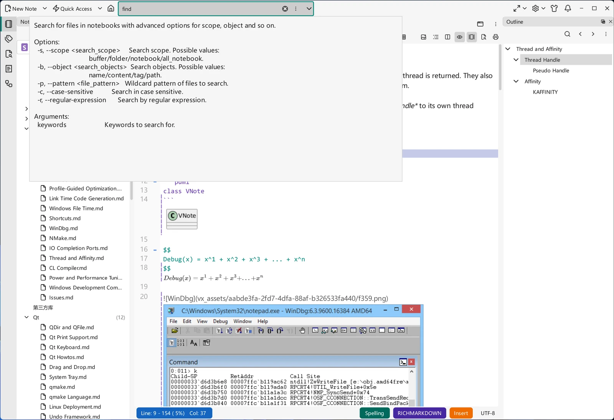

# 统一入口

**统一入口**是 VNote 面向键盘操作的快捷搜索。输入普通文本即可**跨所有已打开的笔记本搜索文件名**。要使用命令或别名，必须以显式的 **`>`** 前缀开头，例如 `>history` 或 `>g interface`。没有 `>` 时，`task`、`find` 等词也会按文件名查询。这种输入方式始于 [4.14.0](https://github.com/vnotex/vnote/releases/tag/v4.14.0)。

## 激活方式

默认按 `Ctrl+G, G` 激活统一入口。你可以在配置文件中修改 `"UnitedEntry": "Ctrl+G, G"`（参见[设置](../customization/settings.md)），换成你习惯的快捷键。

输入为空时会显示可用命令。输入 `>` 后跟命令名可进入命令模式；在命令后加一个**空格**会显示该命令的详细帮助。

**设置 → 统一入口 → 全部展开（Expand All）**控制是否自动展开结果分组。新配置默认启用，已有配置则保留已保存的选择。自 [4.14.1](https://github.com/vnotex/vnote/releases/tag/v4.14.1) 起，此偏好位于独立的统一入口设置页面。

{ .screenshot loading=lazy }

## 入口命令

统一入口内置了五条命令，另外还提供了几个用于常见搜索的短别名。每条命令或别名都必须加上 `>` 前缀，再与关键词组合执行查询。

内置命令：

| 命令      | 描述                     |
| --------- | ------------------------ |
| `>find`    | 在笔记本中搜索文件       |
| `>help`    | 统一入口的帮助信息       |
| `>history` | 最近打开的文件           |
| `>windows` | 跨工作区打开的窗口       |
| `>task`    | 运行任务                 |

`>task` 命令会列出你定义的可运行[任务](../productivity/tasks.md)，因此无需打开任务停靠部件即可启动任务。列表中只有叶子任务，因为只有它们可以运行；分组中的任务显示为 `parent/child`。在命令之后输入内容会按标签筛选列表，且不区分大小写。没有任何任务时显示**没有任务（No tasks）**；筛选后没有匹配项时显示**没有匹配的任务（No matching tasks）**。笔记本范围的任务在求值变量或执行前，仍然需要[本机笔记本信任授权](../productivity/tasks.md#notebook-task-trust)。

默认别名（常见 `>find` 查询的快捷方式）区分大小写：`>n`、`>g` 和 `>t` 搜索当前笔记本；`>N`、`>G` 和 `>T` 搜索所有笔记本。别名的大小写选择与控制搜索文本匹配的 `--case-sensitive` 选项相互独立。

| 别名 | 描述                             | 展开为                                  |
| ---- | -------------------------------- | --------------------------------------- |
| `>n`  | 在当前笔记本中按名称搜索文件     | `>find --scope notebook --object name`   |
| `>g`  | 在当前笔记本中按内容搜索文件     | `>find --scope notebook --object content`|
| `>t`  | 在当前笔记本中按标签搜索文件     | `>find --scope notebook --object tag`    |
| `>N`  | 在所有笔记本中按名称搜索文件     | `>find --scope all_notebook --object name` |
| `>G`  | 在所有笔记本中按内容搜索文件     | `>find --scope all_notebook --object content` |
| `>T`  | 在所有笔记本中按标签搜索文件     | `>find --scope all_notebook --object tag` |
| `>b`  | 在打开的缓冲区中按内容搜索文件   | `>find --scope buffer --object content`  |
| `>f`  | 在当前文件夹中按名称搜索文件     | `>find --scope folder --object name`     |

你也可以直接调用 `>find` 并使用选项进行完全控制：

- `-s, --scope`——`buffer`、`folder`、`notebook` 或 `all_notebook`。
- `-b, --object`——`name`、`content`、`tag` 或 `path`。
- `-p, --pattern`——用于限定搜索范围的通配符文件模式。
- `-c, --case-sensitive`——精确区分大小写。
- `-r, --regular-expression`——把关键词视为正则表达式。

## 添加你自己的别名

默认别名只覆盖了 `>find` 能做的一小部分。你可以在配置文件的 `core.unitedEntry.alias` 之下定义自己的单字母（或短）别名（参见[设置](../customization/settings.md)）。请使用未占用的名称，避免覆盖 `t` 等内置别名。每个别名包含 `name`、帮助列表中的 `description` 和存放命令展开内容的 `value`。**JSON 的 `name` 和 `value` 均不要包含 `>`**：VNote 会在解析展开内容时自行添加它。实际输入 `>q example`，但配置应保存为 `"name": "q"` 和 `"value": "find --scope all_notebook --object name"`；参见[该版本的别名解析器](https://github.com/vnotex/vnote/blob/v4.14.4/src/unitedentry/unitedentryalias.cpp)：

```json
"core": {
    "unitedEntry": {
        "alias": [
            {
                "name": "q",
                "description": "Search for files by name in all notebooks",
                "value": "find --scope all_notebook --object name"
            },
            {
                "name": "a",
                "description": "Search for files by content in all notebooks",
                "value": "find --scope all_notebook --object content"
            },
            {
                "name": "z",
                "description": "Search for files by tag in all notebooks",
                "value": "find --scope all_notebook --object tag"
            },
            {
                "name": "e",
                "description": "Search for files by name in current notebook",
                "value": "find --scope notebook --object name"
            },
            {
                "name": "c",
                "description": "Search for files by tag in current notebook",
                "value": "find --scope notebook --object tag"
            },
            {
                "name": "o",
                "description": "Search for files by name in open buffers",
                "value": "find --scope buffer --object name"
            }
        ]
    }
}
```

把任意 `--scope` 与任意 `--object`（`name`、`content`、`tag`、`path`）自由组合，即可搭建你最常用的快捷方式。新别名需重启 VNote 后生效。

!!! note "从旧版 VNote 迁移别名"
    旧版 VNote 使用顶层的 `united_entry.alias` 键，以及 `--target file|folder|notebook` 选项。在当前版本中，别名位于 `core.unitedEntry.alias` 之下，且 `>find` 不再接受 `--target`——改用 `--scope` 和 `--object`。

从低于 **4.14.1** 的版本升级时，VNote 会为**非空**的已保存列表补充缺失的默认别名，同时保留自定义定义。主动清空的列表仍保持为空。此迁移规则见 [4.14.2 发布说明](https://github.com/vnotex/vnote/releases/tag/v4.14.2)。

## 查询示例

- `release plan`——跨所有已打开的笔记本搜索文件名，无需命令。
- `>history`——列出最近打开的文件。
- `>task Git`——按标签筛选可运行的任务。

- `>n 02`——在当前笔记本中查找名称包含 `02` 的文件。
- `>g interface`——在当前笔记本中搜索内容包含 `interface` 的笔记。
- `>G interface`——在所有笔记本中搜索内容包含 `interface` 的笔记。
- `>t java` / `>T java`——在当前笔记本 / 所有笔记本中查找带 `java` 标签的笔记。
- `>b task`——在当前打开的缓冲区中查找 `task`。
- `>find -b tag -s all_notebook java`——在所有笔记本中查找带 `java` 标签的笔记。

## 定位结果

!!! warning "不同操作系统的行为有所不同"

    **macOS**——出现结果后，按 `Tab` 将光标移入下方的结果列表，再按 `Enter` 打开目标。

    **Windows**——搜索完成后默认选中第一个结果，因此你可以直接按 `Enter` 立即打开，也可以先移动选择再打开。

## 统一入口与搜索面板

当你明确知道要找什么并想直接跳转时，统一入口最为快捷。当你需要可浏览的结果和优化选项（正则、大小写）时，请改用[搜索面板](search-panel.md)——两者使用相同的底层搜索。

内容搜索会跳过[加密笔记正文](../managing-notes/encrypted-notes.md)，并显示排除提示；名称和标签仍可搜索。需要跨笔记替换时，请到[搜索面板](search-panel.md)检查结果并使用其替换操作，确认保存与恢复限制。
